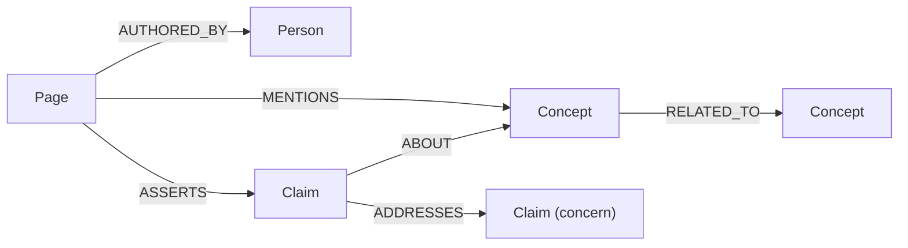
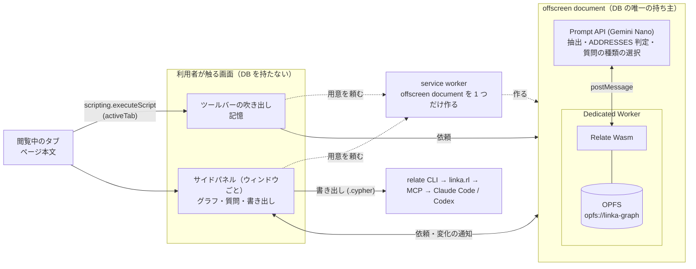

# Linka PRD — Chrome 上で育てるローカル知識グラフ

Linka は、開発者が技術調査で読んだページを Chrome のサイドパネルからクリップし、端末内の知識グラフ（Relate Wasm）として残す Chrome 拡張機能である。この文書は Relate by Neo4j Hackathon への応募作の要件の正である。

- 一行ピッチ（英語、提出用）：*Clip what you read in Chrome into a local knowledge graph — then hand that context to your coding agent.*
- 提出締切：2026-12-11 18:00 PST（日本時間 2026-12-12 11:00）。自分の締切は 12-10 とする
- 体制：個人、週 10 時間程度（合計 約 40 時間）
- 言語：この PRD は日本語。README・UI・デモ動画・Devpost の文面は英語

---

## 1. 目的

技術選定のために複数の記事・ドキュメント・Issue を読み比べる開発者は、今は「どの記事がどの課題を指摘し、どの記事がその解決策を示していたか」をタブとメモと記憶で抱えている。タブを閉じるとその対応関係は失われ、あとで設計判断を説明するときや、コーディングエージェントに作業を頼むときに、同じページを読み直している。

Linka は、読んだページから概念・主張（課題・解決策など）を取り出してページをまたいでつなぎ、次の 2 つをできるようにする。

1. 開発者自身が「この課題に対する解決策を書いていたのはどのページか」を、読み直さずにたどれる
2. 調べた文脈をそのままコーディングエージェント（Claude Code など）に渡せる

### 既存の手段との違い

| 手段 | できること | 足りないこと |
|---|---|---|
| Gemini in Chrome（Ask Gemini） | 今開いているページ・タブについてのクラウドでの質疑応答 | 回答はチャットで消える。ページ間の関係が構造として残らず、書き出せない |
| ブックマーク・メモアプリ | ページを残す | ページの中身どうしのつながり（課題↔解決策）は人が書くしかない |
| Linka | 選んだページから構造を取り出し、ページをまたいでつなぎ、端末内に残す | — |

### 差別化（relate-ideas との関係）

`jexp/relate-ideas` には「閲覧履歴をグラフ化するブラウザ拡張」「ブラウザ内でのエンティティ抽出」が既にある。Linka はそれらと次の点で異なる。

- 履歴を全部入れるのではなく、利用者が選んだページ・範囲だけを入れる
- **ページをまたいで「課題（concern）」と「解決策（solution）」をつなぐ**ことを中心に据える
- **人がブラウザで調べた文脈を、MCP 経由でエージェントの文脈にする**

---

## 2. 保証すること

| 観点 | 約束 |
|---|---|
| プライバシー | 既定では、ページ本文・抽出結果・グラフを端末の外へ送信しない。自前サーバーは使わない（Gemini Nano のモデル取得を除く）。外部 API に送るのは、利用者が §10.1 の設定で外部のエンドポイントを指定し、警告を確認したときだけ |
| 永続性 | クリップした内容は、サイドパネルや Chrome を閉じても残り、次に開いたとき同じグラフが表示される |
| 重複 | 同じ URL を二度クリップしても Page は 1 つ。同じ名前の Concept は 1 つにまとまる（正規化規則は §5） |
| 再クリップ | 同じ URL を再クリップすると、そのページ全体から抽出した Claim と関係は新しい抽出結果で置き換わり、古いものは残らない（選択範囲から足した Claim は残す） |
| 整合性 | 抽出やグラフ書き込みが途中で失敗したら、そのクリップは「失敗」と表示し、既存のグラフは壊さない（§4 UC1 の例外フロー） |
| 読み取り専用の質問 | 質問（UC3）はグラフを変更しない |
| 点検可能性 | グラフの内容を Cypher として書き出せ、Relate CLI で `.rl` ファイルにして中身を確認できる |
| 可観測性 | AI（Gemini Nano）の状態、クリップの成否、質問で実行した Cypher を画面に表示する |
| 複数ウィンドウ | どのウィンドウのサイドパネルからも、同じグラフを見て、記憶し、質問できる |
| 動作保証のない環境 | Gemini Nano が使えない環境でも、同梱データのグラフ表示・書き出し・サンプルページのクリップは動く（質問は Nano が必要） |

## 3. 保証しないこと

- **閲覧履歴の自動収集はしない。** 利用者が明示的にクリップしたものだけを扱う（ノイズとプライバシーのため）
- **抽出の正確さは保証しない。** 抽出結果は小型のオンデバイスモデルによる推定で、誤りがありうる。手で直す編集 UI も MVP では作らない
- **Gemini Nano が使えない環境での質問はしない。** 定型の質問を代わりに出すことはしない（2026-11-15 に決定）。Nano が使えない主な場面は、ハードが条件に届かない（VRAM 4GB 以下かつ RAM 16GB 未満）、空きディスク 22GB 未満、Android・iOS・Chromebook Plus 以外、Chrome 138 未満、会社の管理ポリシーで無効（未確認）
- **モバイル、Chrome 以外のブラウザ、Chrome 138 未満は対象外**
- **端末間の同期はしない。** 持ち出しは書き出し（UC4）で行う
- **Neo4j / Aura との同期はしない。** 書き出した Cypher は他でも使えるが、その手順は扱わない
- **外部 LLM API へ自動では切り替えない。** Nano が使えなくても、利用者が §10.1 の設定をしない限り、本文を外へ送らない
- **ベクトル検索・全文検索 index、主張の矛盾検出（CONTRADICTS）は MVP に入れない**（§9）

## 4. 動かせない前提

| 種類 | 前提 | 出どころ |
|---|---|---|
| ハッカソン | 2026-11-11 以降に作り始めた新規プロジェクトであること。公開 GitHub リポジトリに topic `relate` を付け、結果発表まで公開を保つこと | Official Rules §3 |
| ハッカソン | 審査員が質問せずに clone → 実行 → グラフを確認できること。永続化されたストアを点検できること | Overview の Requirements |
| Relate Wasm | `@relate/relate-wasm`（v1.0.x）。永続化できるのは OPFS（`opfs://<name>`）だけで、**dedicated worker の中で開く必要がある**。`.rl` ファイルは読めない。ストアの import/export API は無い | relate リポジトリ `docs/api/wasm/spec.md`, ADR-0145 |
| Relate Wasm | `execute` は同期で、結果は JSON 文字列。エラーは例外でなく `error` に返る。トランザクション API は無い。panic 後のインスタンスは使えない | 同上 |
| Relate Wasm | 同じ OPFS ストアを開けるのは同時に 1 か所だけ（`storage locked`）。MV3 の service worker からは dedicated worker を作れない | ADR-0145、MV3 の service worker の制約 |
| Prompt API | Chrome 138 以降の拡張機能で利用可能。**Web Worker からは使えない。** offscreen document とサイドパネルでは使える（実記事 1 本の抽出が 2〜4 秒。ただし約 30,000 文字を 1 回で渡すと、環境によっては 90 秒を超えた（2026-11-15、§7））。対応言語は en / ja / es / de / fr | developer.chrome.com/docs/ai/prompt-api、`spikes/offscreen-clip` |
| Prompt API | 必要環境：空きディスク 22GB 以上、VRAM 4GB 超 または RAM 16GB 以上。審査員の環境の 2〜4 割では動かないと見込む | 同上（割合は推定） |
| Prompt API | コンテキストは 9216 トークン（`contextWindow` と `inputQuota`）。英語の本文は約 4.5 文字で 1 トークン。長い記事は分割が必要 | Chrome 157（macOS）で実測（2026-11-15） |
| Prompt API | 同じセッションに 2 回目の `prompt` を送ると、`kErrorUnknown` ですぐ失敗することがある（Cypher の作り直しで 4 回中 4 回）。`clone` したセッションへの 1 回目は通る | 同上 |

---

## 5. 扱う概念（グラフモデル）

ノードと関係は次のとおり。重複と再クリップの扱いも決めておく。

| ノード | プロパティ | 識別の仕方（MERGE のキー） |
|---|---|---|
| `Page` | `url`, `title`, `summary`, `clippedAt`, `source`（`page` / `selection` / `sample`） | `url`（フラグメントと `utm_*` などの追跡パラメータを除いて正規化） |
| `Concept` | `key`, `name`（表示名）, `category` | `key` = 名前を NFKC で揃えて小文字化し、空白・ハイフン・アンダースコアを除いたもの（`Web Assembly`/`web-assembly`/`WebAssembly` はここで同じになる）を、別名表（`wasm` → `webassembly` など）で寄せたもの。記号や空白だけで key が空になる名前は Concept にしない |
| `Person` | `name` | `name` を正規化したもの（前後と連続する空白、互換文字を揃える。表示にも使うので大文字小文字は変えない） |
| `Claim` | `id`, `statement`, `type`（`benefit` / `concern` / `solution` / `fact`）, `source`（`page`：ページ全体から抽出 / `selection`：選択範囲から / `sample`：同梱サンプルの事前抽出） | `id` = 正規化 URL ＋ `#claim-` ＋ 文（空白を揃えたもの）の FNV-1a 64 ビットのハッシュ |

- `ADDRESSES` は「あるページの solution が、**別のページ**の concern を解決する」場合だけ張る。同じページ内では張らない
- 再クリップでは、そのページが `ASSERTS` する Claim のうちページ全体から抽出したもの（`source` が `page` と `sample`。それに付いた `ABOUT`・`ADDRESSES` も）と、ページの `MENTIONS`・`AUTHORED_BY` を消してから入れ直す。ただし、残した選択範囲の Claim が `ABOUT` で指す Concept への `MENTIONS` は張り直す。Concept と Person は他のページが参照しうるので消さない。Concept 同士の `RELATED_TO` もページをまたいで積み上がる関係で、ページの持ち物ではないので消さない
- 選択範囲のクリップ（§10 で後回し）は、同じ URL の Page に Claim を**追加**する。選択範囲から足した Claim は再クリップでも消さない（利用者が自分で選んだものだから。2026-11-15 に決定）。選択範囲のクリップでは Page の `title`・`summary` などを上書きしない。ページ全体の抽出が選択範囲と同じ文を出したときは同じ Claim になり、`source` は `selection` のまま残す

---

## 6. ユースケース

利用者は「技術調査をする開発者」。UC4 だけは、利用者が使うコーディングエージェントも登場する。

### UC1 読んでいるページを記憶する

- 事前条件：グラフのストアが使える（サイドパネルは開いていなくてよい）
- 主フロー：
  - 利用者がツールバーの Linka アイコンを押すと、ブックマークと同じ要領で、アイコンの下に小さな吹き出しが出て記憶が始まる
  - 今のタブのタイトル・URL・本文（主要部分のみ）が読み取られる
  - 本文から summary・Concept・Person・Claim が抽出され、グラフに入る
  - 吹き出しに、記憶した件数と新しいつながり（UC2）が表示される。吹き出しを閉じても処理は最後まで続く
  - 記憶済みのページでは、ツールバーのアイコンに記憶済みの印が付く
  - サイドパネルが開いていれば、グラフに新しいノードと関係が追加表示される。既存の同名 Concept には新しいページからの線がつながる
  - 続けて UC2 が走る
- 代替フロー：
  - サイドパネルが開いていれば、記憶の進み具合と結果はサイドパネルにも表示される。サイドパネルには記憶ボタンを置かず、「ツールバーの Linka アイコンを押して記憶する」と案内する（サイドパネルのボタンでは `activeTab` が付与されず、ページを読めないため。§13）
  - 記憶済みのページでアイコンを押すと、吹き出しに「記憶済み」と「記憶し直す」「サイドパネルで見る」が出る
  - 同じ URL を再クリップすると、そのページ由来の内容が置き換わる（§5）
  - 本文が長い場合は分割して抽出し、結果をまとめる
- 例外フロー：
  - Gemini Nano が使えない（`unavailable`）：同梱サンプルの URL なら事前抽出済みデータで記憶する。それ以外は「この環境では AI 抽出が使えない」と理由を表示し、グラフを変更しない
  - モデルのダウンロード中（`downloadable` / `downloading`）：進捗を表示し、終わるまでクリップを受け付けない
  - `chrome://` などスクリプトを実行できないページ、本文が取れないページ：理由を表示し、グラフを変更しない
  - 抽出結果が期待する形でない：1 回だけやり直し、それでも駄目なら失敗を表示してグラフを変更しない
  - グラフへの書き込みが途中で失敗：そのページ由来の書きかけを消し、失敗を表示する
  - 抽出中に同じページのクリップがもう一度要求された：先の処理が終わるまで受け付けない
  - 吹き出しを開いている間に別のページの記憶が進んでいる：その旨を表示し、終わってから押し直してもらう
- 事後条件：
  - グラフに、そのページの Page が 1 つだけあり、抽出された Concept・Claim とつながっている
  - 記憶を始めたあとで吹き出しやサイドパネルを閉じても、上の状態になっている
  - サイドパネルと Chrome を閉じて開き直しても、同じ内容が表示される
  - 他のページ由来の Claim は変わっていない

### UC2 ページをまたぐ課題と解決策をつなぐ

- 事前条件：UC1 で新しい Claim が入った
- 主フロー：
  - 新しいページの solution と、既存の**別ページ**の concern のうち同じ Concept を持つものを候補として集める。すでに `ADDRESSES` がある組は除く
  - 候補は、共有する Concept の多い組から、新しいページの Claim 1 つにつき 5 組、記憶 1 回で合わせて 10 組までにする（2026-11-15 に決定。理由は下）
  - 候補の組ごとに「この solution はこの concern を解決するか」を判定し、該当する組に `ADDRESSES` を張る。判定は抽出と同じく 1 回ごとにセッションを `clone` し、`responseConstraint` で答えの形（`addresses` の真偽）を指定する。1 回ごとに 30 秒で打ち切り、失敗の文に秒数（`no answer within 30 s`）を入れる。1 回ごとの所要時間は offscreen document のコンソールに出す
  - 新しくつながった組を「New connections」として吹き出しとサイドパネルに表示し、サイドパネルのグラフ上で強調する
  - 判定も記憶の処理の中で走る（UC1 の書き込みが済んだあと）。その間、ほかのページは記憶できない
- 組の数の上限の理由：判定 1 回の入力は 2 つの文と Concept の名前だけ（約 100 トークン）で、出力も `{"addresses":true}` の数トークンなので、抽出 1 回（約 8,000 文字、実測 10〜12 秒）よりずっと短いと見込む。上限 10 組なら、記憶の待ち時間の延びは通常の環境で数十秒と見込む。最悪は、どの組でも 1 回目の答えが打ち切り（30 秒）近くかかって形が違い、やり直しも 30 秒近くかかる場合で、10 組 × 2 回 × 30 秒 ≒ 10 分になる（時間切れになった組はやり直さず、その時点で判定をやめるので、これより延びない）。新しいページの Claim 1 つあたり 5 組にするのは、Claim が多いページで 1 つの Claim が上限を使い切らないため。デモデータの 15 ページのどれを記憶し直したとき（そのページの `ADDRESSES` が消えた状態）も、候補は 9 組以下で、上限で切られない。**判定 1 回の所要時間は Nano が動く Chrome でまだ測っていない**。コンソールに出る時間を見て、上限と打ち切りを見直す
- 代替フロー：
  - 新しいページの concern に対しても、既存の solution から同様に候補を集める
  - 候補が無ければ何もせず、「つながりは見つからなかった」と表示する
- 例外フロー：
  - Gemini Nano が使えない：UC2 は行わず、UC1 の結果だけを残す
  - 判定が失敗した・時間切れになった・答えが期待する形でなかった（1 回やり直しても）：その時点で判定をやめ、それまでに「解決する」と答えた組も含めて `ADDRESSES` を張らずに終える（UC1 の結果は残す）。記憶は成功として扱い、「つながりは判定しなかった」と理由を表示する
  - `ADDRESSES` の書き込みが失敗した：張りかけた分を消し（ほかの取り消しと同じく 3 回まで流し直す）、判定しなかったときと同じ表示にする（UC1 の結果は残す）。消しきれなかったときは、Nano が解決すると答えた組の一部が残りうることを表示する
  - `ADDRESSES` を書いたあとで、張れた組を読み直せなかった（同梱サンプルの組）：つながりは保存されたかもしれないが確かめられなかったと表示する（UC1 の結果は残す）
- 事後条件：
  - `ADDRESSES` は異なるページの Claim の間にだけ存在する
  - UC1 で入った Page・Concept・Claim は変わっていない

### UC3 グラフに自由文で質問する

- 事前条件：グラフに 1 ページ以上ある
- 主フロー：
  - 利用者が英語で質問を入力する（例：*Which pages propose solutions to the concerns about WebAssembly memory?*）。入力欄は複数行で、Enter は改行、⌘/Ctrl + Enter または送信ボタンで送る（日本語の変換確定の Enter では送らない）
  - 質問が、用意した問い合わせの種類（下の表）と、その対象（グラフにある概念の名前）に置き換えられる。どの種類と対象にするかは Gemini Nano が選び、Cypher は種類ごとに用意したものに対象を入れて作る
  - 実行した Cypher と結果の一覧（ページへのリンク付き）が表示され、結果に含まれるノードと関係がグラフ上で強調される
  - 結果のページノードを押すと、そのページが新しいタブで開く
- 例外フロー：
  - どの種類にも当てはまらない、または対象の概念がグラフに無い：何も実行せず、答えられる質問の種類の例と、グラフにある概念の名前を表示する
  - 結果が 0 件：「該当なし」と、実行した Cypher を表示する
  - 結果が多すぎる：先頭の一定件数（例：50 件）だけを表示する
  - Gemini Nano が使えない：入力欄の代わりに、質問には端末内 AI が必要なことを表示する。ダウンロード中なら、終われば使えることを表示する
  - 質問の実行が終わらない：一定時間で打ち切り、失敗を表示する（グラフは使える状態に戻る）
- 事後条件：
  - グラフの内容は変わっていない
  - 表示された Cypher を CLI（UC4）で実行すると、同じ結果が得られる

答えられる問い合わせの種類（Phase 1 の 10 問から。Cypher は `src/dev/questions.ts` の答えの Cypher を元にする）：

| 種類 | 質問の例 |
|---|---|
| 概念についての課題 | What concerns are there about OPFS? |
| 概念についての課題を解決する解決策 | Which solutions address concerns about offline support? |
| 概念に触れるページ | Which pages mention IndexedDB? |
| 2 つの概念を両方含むページ | Which pages mention both OPFS and Web Worker? |
| 概念に触れるページの著者 | Who wrote the pages that mention SQLite? |
| 関係する概念 | Which concepts are related to Web Worker? |
| 多くのページに出てくる概念 | Which concepts are mentioned by more than three pages? |
| 種類ごとの Claim の数 | How many claims of each type are there? |
| あるページの課題に解決策を出しているページ | Which pages propose solutions to the concerns raised on the local-first software page? |

### UC4 調べた文脈をコーディングエージェントに渡す

- 事前条件：グラフに 1 ページ以上ある。利用者の端末に Relate CLI がある
- 主フロー：
  - 利用者が「Export」を押すと、グラフ全体を再現する Cypher ファイル（`linka-export.cypher`）がダウンロードされる
  - 利用者が `relate query -d linka.rl < linka-export.cypher` で単一ファイルのストアにする（`query` を省いた `relate -d linka.rl < …` は文を実行せず、ヘルプを出して 0 で終わる）
  - 利用者が Relate の MCP サーバー（`relate serve --database linka.rl --read-only --mcp stdio`）をコーディングエージェントに登録する。手順は Claude Code（`claude mcp add`）と Codex（`~/.codex/config.toml` の `[mcp_servers.linka]`）の両方をタブで切り替えて示す。`--read-only` を付けると、エージェントに見えるツールは `read_cypher` と `get_schema` だけになり、ファイルも書き換わらない（付けないと `write_cypher` も出て、エージェントがグラフを書き換えられる）。`linka.rl` は絶対パスで書き、`DO_NOT_TRACK=1` を環境変数に入れる
  - エージェントに「調べた課題と解決策を踏まえて実装方針を出して」と頼むと、エージェントがグラフを問い合わせて答える
- 代替フロー：
  - 渡し方の説明は、書き出した直後だけでなく、サイドパネルのメニューからいつでも開ける。そこからも書き出せる
  - MCP を使わず、`relate query --read-only -d linka.rl "<Cypher>"` で直接 Cypher を実行して中身を確かめられる（`--read-only` を付けないと、読むだけでもファイルが書き換わる）
- 例外フロー：
  - グラフが空：Export を押せないようにする
  - 書き出したファイルの読み込みで失敗する：CLI は 0 以外（文法・型のエラーは 6）で終わり、何番目の文で失敗したかを出す。それより前の文は確定して残るので、`linka.rl` を消してから作り直す。README に手順と、確認済みの Relate のバージョンを書いておく
  - 書き出し直した：前の `linka.rl` に読み込むと、消したページが残るので、`linka.rl` を消してから作る
- 事後条件：
  - `linka.rl` を CLI で問い合わせると、サイドパネルと同じ件数の Page・Concept・Claim・関係が返る
  - 書き出しによってサイドパネル側のグラフは変わっていない

### UC5 初めて開いて、すぐ試す

- 事前条件：拡張機能を読み込んだ直後で、ストアが空
- 主フロー：
  - サイドパネルを初めて開くと、同梱のデモデータ（技術調査 10〜15 ページ分）が入ったグラフが表示される
  - AI の状態（Ready / Downloading x% / Not available とその理由）が表示される
- 代替フロー：
  - 「Reset to demo data」で、いつでもデモデータの状態に戻せる（確認ダイアログあり）
  - 拡張機能に同梱したサンプルページは、Gemini Nano が無くてもクリップできる（本文は読まず、同梱の事前抽出データを使う）
- 例外フロー：
  - OPFS が使えない（この環境で一度も開けていない）：メモリ上のグラフで動かし、「閉じると消える」と表示する
  - ストアを一時的に開けない（ロック中・時間切れ・panic のあと、または一度 OPFS で開けたあとに開き直せない）：メモリには切り替えない（書き込みが再起動で黙って消えるため）。その間の操作は失敗し、「グラフを開けない」と理由を表示する。次の操作で開き直す
- 事後条件：
  - 2 回目以降に開いたときは、デモデータで上書きせず、前回の状態が表示される
  - 同梱の `data/linka.rl` を CLI で問い合わせた結果と、初回に表示されるグラフが同じ内容である

---

## 7. 実装方針

要件ではなく、§4 の前提から決まる構成。詳細は実装時に決める。

- MV3。権限は `sidePanel`, `offscreen`, `activeTab`, `scripting`, `storage`、それにアイコンの記憶済みの印のための `tabs`（`tabs` が無いと、ほかのタブの URL が読めない。Chrome 157 で、タブの切り替え・移動のどちらでも `tab.url` が空だった。入れるとインストール時に「閲覧履歴の読み取り」の警告が出るが、受け入れる。2026-11-15 に決定）。選択範囲のクリップを入れるときは `contextMenus` を足す。CSP に `'wasm-unsafe-eval'`。`minimum_chrome_version: "138"`。ツールバーのアイコンは `action.default_popup` で吹き出しを開く
- 使う技術は §7.1 のとおり
- DB は offscreen document（reason は `WORKERS`）1 か所だけが持ち、その中の dedicated worker で Relate を開く。service worker は offscreen document を 1 つだけ作る役で、依頼は取り次がない。吹き出しとサイドパネルは、service worker に offscreen document を用意させてから、依頼を offscreen document に直接送る。DB の変化は offscreen document から拡張機能のすべてのページに直接知らせる。service worker は Chrome に休止させられることがあり、長い依頼の返事を service worker が持っていると、書き込みは済んだのに返事だけが失われるため。吹き出しが閉じても処理は offscreen document で続き、完了はサイドパネルに通知する（`spikes/offscreen-clip` で確認済み）
- worker へのメッセージは 1 件ずつ処理する。panic（`isWasmTrap`）が起きたら worker を作り直す
- Prompt API は offscreen document から呼ぶ（Worker からは使えないため）。抽出と判定には `responseConstraint` を使い、zod が作る JSON Schema をそのまま渡す（`$schema`・`minLength`・`maxLength`・`maxItems` を含めて受け付けられ、出力は zod の検査に通った）。概念名には説明の注記（例：`OPFS (Origin Private File System)`）が付くことがあるので、プロンプトで「名前だけ」と指示する（指示すると 39 個中 0 個、指示しないと 46 個中 1 個）。1 回の `prompt` ごとに、指示を入れたセッションを `clone` して使う（§4）。本文は約 8,000 文字ずつに分けて抽出する。入力の上限（出力に 700 トークンを残して 2 割の余裕を引くと約 6,700 トークン、英語で約 30,000 文字）までは入るが、約 30,000 文字を 1 回で読ませると、遅い環境では 1 回の打ち切り（90 秒）を超えて失敗した。GPU / CPU のどちらで動くかは Chrome が決め、拡張機能からは選べないので、遅い環境でも各回が打ち切りの内に終わる短さにする。回数は増えるが、進み具合（part n of m）が見える。8,000 文字は出発点で、offscreen document のコンソールに出す 1 回ごとの所要時間を見て調整する（2026-11-15 に決定）
- 抽出結果はコード側で、パラメータ付きの MERGE 文に変換して書き込む。質問（UC3）も、モデルには種類と対象を選ばせるだけで、Cypher はコードが作る
- 同じ `seed/demo.cypher` を、拡張機能の初回投入（`executeScript`）と、CLI での `data/linka.rl` 生成の両方に使う。Export も同じ形式で出し、CLI でもそのまま読めるようにする

### 7.1 使用技術（2026-11-15 確定）

バージョンは固定する（`--save-exact`）。どれも 2026-11-15 時点の正式版の最新（npm の `latest`）で、プレビュー版（beta・rc・next など）は選ばない。「確認」の列は、この組み合わせで実際に動かしたかどうか。型検査・単体テスト・ビルド・lint は、下の組み合わせを使い捨てのプロジェクトに入れて、すべて通ることを確認した。

| 用途 | 技術 | バージョン | 選んだ理由 | 確認 |
|---|---|---|---|---|
| グラフ DB | `@relate/relate-wasm` | 1.0.1 | ハッカソンの必須。offscreen document の dedicated worker で OPFS に永続化する | 検証 1・2 |
| 端末内 AI | Chrome Prompt API（Gemini Nano） | Chrome 138 以上 | 端末の外へ送らずに抽出と質問ができる。`responseConstraint` で出力の形を指定する | 検証 2 |
| 拡張機能 | Manifest V3（`action` の吹き出し、`side_panel`、`offscreen`、`activeTab`、`scripting`、`contextMenus`） | — | §7 の構成 | 検証 1・2 |
| UI | React + TypeScript | React 19.3.1 / TypeScript 7.0.2 | 普段から使っていて、部品が増えても管理しやすい | 型検査 |
| ビルド | Vite + `@vitejs/plugin-react` | 8.3.8 / 6.3.0 | 複数の HTML を入口にし、`manifest.json` は `public/` からそのままコピーする。拡張機能用のビルド補助（`@crxjs/vite-plugin` など）は入れない（素の Vite で足りることを検証で確認したため） | 検証 1・2、ビルド |
| グラフ描画 | `react-force-graph-2d` | 1.29.2 | 力学モデルで配置するのがモックの見え方に合う。Canvas 描画で、ノードの形（ページ・概念・課題・解決策）を自分で描ける。強調表示は React の状態で切り替える | ビルド |
| 本文抽出 | `@mozilla/readability` | 0.6.0 | Firefox のリーダービューと同じ仕組みで、記事の主要部分だけを取り出せる。`scripting.executeScript` でページの中で動かす。取り出せないページは `document.body.innerText` に戻す。最終更新は 2025-03 だが、機能は安定している | 型検査 |
| 型とその検証 | `zod` | 4.6.7 | 1 つの定義から、`responseConstraint` に渡す JSON Schema（`z.toJSONSchema`）と、AI の出力を実行時に確かめる処理の両方を作れる | 単体テスト |
| 見た目 | 素の CSS（CSS Modules と CSS カスタムプロパティ） | — | モックの色と文字の指定をそのまま移せる。Tailwind や CSS-in-JS は入れない | — |
| 状態管理 | React の state と context | — | データの正は offscreen document の DB で、画面は問い合わせた結果を持つだけなので、状態管理のライブラリは要らない | — |
| 画面と DB のやり取り | `chrome.runtime` のメッセージ（型は共有の TypeScript 定義） | — | ライブラリは入れない | 検証 2 |
| 単体テスト | Vitest | 5.1.0 | Vite と同じ設定で動く。Cypher の組み立て、Concept 名の正規化、書き込みの拒否、スキーマを確かめる | 単体テスト |
| E2E テスト | Playwright | 1.65.1 | 拡張機能を Chromium に読み込んで自動で確かめる方法が、検証で使えた。CI にはコストが重いので当面入れず、単体テストを重視する | 検証 1・2 |
| lint と整形 | Biome | 2.6.7 | 1 つの道具で lint と整形をまかなえる | 動作 |
| 実行環境 | Node.js / npm | 26.13.1（現行の LTS）/ 12.2.2 | 開発者ごとの版のずれを防ぐため、`package.json` の `volta` と `engines` で固定する | 型検査・単体テスト・ビルド・lint・E2E |
| `.rl` の作成と MCP | Relate CLI | 1.0.1（拡張機能の Wasm と同じ版） | `data/linka.rl` の作成と、UC4 の MCP 接続に使う。公式のインストーラ（`curl -sSfL https://relatedb.ai/install.sh \| bash`）が、署名と checksum を確かめてから `~/.local/bin/relate` に入れる。sudo は要らない。インストーラは常に最新版を入れるので、版を固定したいときは GitHub の Release `v1.0.1` から `relate-darwin-arm64` などを直接取る。CLI は初期設定で利用状況を送信するので、README では `DO_NOT_TRACK=1` か `relate telemetry off` を案内する | macOS（arm64）で `npm run store`、`relate serve --mcp stdio`、Claude Code と Codex からの問い合わせ |
| ライセンス | MIT | — | ハッカソンの推奨 | — |

リポジトリの構成は 1 つのパッケージとし、`src/` の下を動く場所ごとに分ける：`background/`（service worker）、`offscreen/`（DB と AI）、`popup/`、`sidepanel/`、`content/`（ページの読み取り）、`shared/`（メッセージの型とスキーマ）。デモデータは `seed/`、同梱するストアは `data/` に置く。`mock/` と `spikes/` は参考として残す。

---

## 8. ハッカソン提出物の対応表

| 要件（出どころ） | 対応 | 状態 |
|---|---|---|
| 公開リポジトリと topic `relate`（Rules §3・§4、Overview） | topic は設定済み。`relate-neo4j-hackathon` も付ける。リポジトリは self-hosted runner を消すまで private のままにし、提出の直前に公開する（#4） | topic は設定済み、公開は未 |
| プロジェクトの説明：何をするか・なぜ役立つか・何と何をつなぐか（Rules §4、Overview） | Devpost に英語で書く（§1 から） | 未着手 |
| README（setup / use、指定テンプレート）（Overview） | Use case / How it uses Relate（Mode：拡張機能内は OPFS、同梱は single file。理由：Wasm で永続化できるのは OPFS だけで、審査員が点検できるよう同じ内容を `.rl` でも同梱）/ Setup and run / Where the data lives | 未着手 |
| 永続化されたストア（Overview） | `data/linka.rl`（`seed/demo.cypher` から `npm run store` で生成し、コミットする）。同じ seed から作り直してもバイト列が一致しないので、seed を変えたときだけ作り直す。問い合わせは `--read-only` で開く（付けないと読むだけでもファイルが書き換わり、差分が出る） | 作成済み（seed を変えたら作り直す） |
| Relate が実際に動いているコード（Overview） | 拡張機能本体 | 未着手 |
| デモ（2 分以内、ログイン不要で見られる）（Rules §4、Overview） | YouTube 限定公開などで 1 分 30 秒〜2 分 | 未着手 |
| 使った Relate の機能・サードパーティツール・AI ツールの申告（Rules §3・§4） | Relate（Wasm・OPFS・Cypher・CLI・MCP）、使用ライブラリ、Gemini Nano（実行時）、Claude Code と Gemini（開発時）を README と Devpost に書く | 未着手 |
| 2026-11-11 以降の新規作成（Rules §3） | 最初のコミットの日付で示す。流用したコードがあれば明記する | 遵守 |
| ライセンス（Rules §3、推奨） | MIT | 未着手 |

## 9. 審査基準への対応

| 基準（Overview の配点） | 応え方 |
|---|---|
| Relate and connected context（30） | ページをまたぐ `ADDRESSES` と多段の経路の質問を中心に置き、結果の経路をグラフ上で強調する。OPFS での永続化、`.rl` と MCP での連携まで Relate の機能を通して使う |
| Functionality and completeness（25） | Nano が無い環境でも、デモデータ・サンプルのクリップ・書き出しが動く（UC5）。質問は Nano が必要 |
| Usefulness（20） | 「技術選定の調査 → エージェントへの引き継ぎ」という一続きの流れをデモで見せる |
| Documentation and reproducibility（15） | `npm install && npm run build` → `chrome://extensions` で `dist/` を読み込む、の手順だけで UC5 まで届くようにする。CLI での `.rl` の確認手順も載せる |
| Creativity（10） | 課題↔解決策のつながりと、人の調査をエージェントの文脈にするという使い方 |

## 10. MVP の範囲

| MVP | 後回し（時間が余ったら） |
|---|---|
| UC1〜UC5 | 全文検索 index によるページ検索（Wasm での動作が未確認） |
| | ベクトル検索（Chrome に組み込みの埋め込みモデルが無い） |
| | Claim の矛盾検出（`CONTRADICTS`） |
| | 抽出結果の手動編集 |
| | 日本語ページの抽出（Nano は ja に対応しているが、デモと審査は英語で行う） |
| | 右クリックメニューからの選択範囲のクリップ（UC1 の代替フローから外した。2026-11-15 に決定） |
| | AI の切り替え（§10.1。優先度は最も低い） |

### 10.1 追加機能：AI のエンドポイントを切り替える（優先度：低）

Nano が使えない環境や、Nano より大きいモデルで抽出と質問の質を上げたい利用者のために、AI の呼び出し先を設定で切り替えられるようにする。MVP（UC1〜UC5）が W3 までに通り、W4 の提出準備に余裕がある場合だけ着手する。入れなくても提出には影響しない。

- 目的：Nano が使えない利用者でも、手元の LLM（Ollama、LM Studio など）か外部 API で、記憶・つながりの判定・質問を使えるようにする
- 対応先：OpenAI 互換のエンドポイント（`/v1/chat/completions`）1 種類だけ。出力の形は JSON Schema で指定する。既定は Gemini Nano で、切り替えは利用者が設定したときだけ
- 設定項目：エンドポイントの URL（初期値の候補は `http://localhost:11434/v1`）、モデル名、API キー（外部 API の場合）
- 保証すること：
  - 外部のエンドポイント（localhost 以外）を指定したときは、保存前に「ページ本文がこの送信先に送られる」ことを表示し、利用者が確認するまで有効にしない
  - 送信先への通信許可は、設定したときに Chrome の許可ダイアログで求める（`optional_host_permissions`）。事前に全サイトの許可は取らない
  - API キーは端末内にだけ保存し、書き出し（UC4）には含めない
  - 接続に失敗したら、原因（接続できない、認証に失敗、出力の形が違う）を表示し、Nano が使えるなら Nano に戻すか利用者に選んでもらう
- 保証しないこと：
  - OpenAI 互換でない API（各社の独自形式）への対応
  - 出力の形を JSON Schema で指定できないモデルでの動作
  - 送信先ごとのプロンプトの調整
- 前提：ブラウザ拡張機能から localhost の Ollama を呼ぶには、Ollama 側で拡張機能のオリジンを許可する設定（`OLLAMA_ORIGINS`）が必要。手順は README に書く
- 見積もり：4〜8 時間（AI の呼び出しを差し替えられる形にする、設定画面、通信許可の要求、API キーの保管、エラー処理、2 系統の動作確認）

## 11. マイルストーン

| 週 | 期間 | やること | 終わりの判定 |
|---|---|---|---|
| W1 | 〜11/23 | Phase 1：拡張機能の土台、DB 層、ドメイン処理、デモデータ、残りの検証（`responseConstraint`、Nano が書く Cypher の成功率をデモデータ相手の質問 10 問で、権限、Relate CLI） | 検証の結果が出て、§13 の未決事項が決まっている |
| W2 | 〜12/02 | Phase 2：UC1 と UC5（クリップ → 抽出 → 書き込み → グラフ表示、デモデータ投入） | 記事 3 本をクリップして、再起動後も残っている |
| W3 | 〜12/07 | Phase 3：UC2・UC3・UC4 | デモの筋書きを最初から最後まで通せる |
| W4 | 〜12/10 | Phase 4：`data/linka.rl`、README、動画、Devpost 提出 | 提出済み、topic と公開状態を確認済み |

各フェーズは GitHub の milestone で管理し、最後の振り返りで PRD との食い違い・考慮漏れ・決めるべきことを確かめてから次に進む。見積もりの合計は約 40 時間で、使える時間（約 36 時間）を少し超えるが、受け入れる（2026-11-15 に決定）。

W1 のスパイクで Nano の Cypher 生成の成功率が低い（10 問中 5 問未満）場合は、Nano に Cypher を書かせず、用意した問い合わせの種類と対象だけを選ばせる方式に切り替える（画面は自由文の入力欄のまま）。→ 10 問中 2 問しか正しくなかった（実行できたのは 7 問、うち 4 問は 0 行。Chrome 157 で 2026-11-15 に計測）ので、切り替える（UC3）。

## 12. リスクと対策

| リスク | 対策 |
|---|---|
| 審査員の環境で Gemini Nano が動かない | UC5 のデモデータ・サンプルのクリップ・書き出しは Nano 無しで動く。質問は試せないので、README と動画で Nano が動く環境での質問の流れを見せる |
| Nano が書く Cypher が壊れる | **解消（2026-11-15）。** 成功率が 10 問中 2 問だったので、Cypher はコードが作る方式に切り替えた（§11、UC3） |
| 長い記事がコンテキストに入らない | 本文の主要部分だけを取り、分割して抽出する |
| Relate 1.0.x の変更（11/11 公開、更新が速い） | バージョンを固定し、README に確認済みのバージョンを書く |
| OPFS のロックで 2 つ目のウィンドウが使えない | **解消（2026-11-15）。** DB を offscreen document 1 か所に置き、サイドパネルはそこへ問い合わせる。`spikes/offscreen-clip` で、2 つのサイドパネルから同時に問い合わせられることを確認した |
| 拡張機能のページから OPFS の Worker が使えない | **解消（2026-11-15）。** `spikes/relate-opfs` で、拡張機能のページから起動した dedicated worker で OPFS に書き込めること、ページの開き直し・ブラウザの再起動後も残ること、2 か所目は `storage locked` になることを確認した（Playwright の Chromium 159 での自動確認に加え、Chrome 157 の実際のサイドパネルでも、閉じて開き直したあと・Chrome を再起動したあとに件数が変わらないことを手動で確認した） |
| サイドパネルを開かずに記憶できない（吹き出しは閉じると止まる） | **解消（2026-11-15）。** `spikes/offscreen-clip` で、吹き出しを閉じても offscreen document で記憶が最後まで終わること、offscreen document で Gemini Nano が実際の記事から抽出できること（2〜4 秒）、35 秒放置しても offscreen document が残ること、ブラウザの再起動後もデータが残ることを確認した（Playwright の Chromium での自動確認と、Chrome での手動確認） |

## 13. 未決事項（Phase 1 で決める）

- ~~zod が作る JSON Schema を、`responseConstraint` がそのまま受け付けるか~~ → そのまま受け付ける（2026-11-15 に確認）。§7
- ~~分割の大きさ~~ → 約 8,000 文字ずつ（2026-11-15 に決定）。入力の上限ではなく、遅い環境でも 1 回が打ち切りの内に終わる長さで決めた。§7
- ~~質問の書き込み拒否を、キーワード検査だけにするか、`EXPLAIN` の実行計画も見るか~~ → キーワード検査だけにする（2026-11-15 に決定）。Cypher を字句に分けてから句のキーワードを探すので、文字列・コメント・プロパティ名・ラベル・マップのキーにある同じ綴りでは拒否しない。`INSERT`（Relate 1.0.1 は GQL の `INSERT` で書き込む）とスキーマ・管理の句も拒否し、手続きの呼び出しはグラフの形を読む `db.labels` などだけを通す。閉じていない文字列やコメントは拒否する。`EXPLAIN` を使わない理由は、Relate の実行計画では `CALL { … }` の副問い合わせが `CallSubquery` の 1 つにまとまり、中の書き込みが見えないため（キーワード検査より見落とす）。UC3 の方式を変えたあと（§11）は、モデルの書いた Cypher を検査する場面は無くなり、用意した問い合わせがすべて読み取り専用であることを単体テストで確かめるのに使う
- ~~Concept の別名表の持ち方~~ → コードの中の定数（`src/shared/concept-key.ts` の `CONCEPT_ALIASES`）にする（2026-11-15 に決定）。拡張機能・seed の生成・書き出しが同じ key を作る必要があり、コードに置けば 1 か所で済み、テストで表の形（左右とも正規化済み・別名の連鎖が無い・複数形は単数形に寄せる）を確かめられる。MVP には表を編集する画面が無いので、グラフや設定に持つ理由が無い。表を変えても、すでにグラフにある key は書き換わらない（新しいクリップから効く）
- ~~アイコンの記憶済みの印に `tabs` 権限が要るか~~ → 要る（2026-11-15 に確認）。§7
- ~~サイドパネルの記憶ボタンで `activeTab` が付与されるか~~ → 付与されない（2026-11-15 に確認）。アイコンを押したことのないタブでは、サイドパネルを開いた直後もボタンを押した後も `executeScript` が「Cannot access contents of the page」で失敗した。アイコンを押したことのあるタブでは成功したので、許可はアイコンを押したときに付く。記憶はアイコンの吹き出しからだけ始める（UC1）
- モデルのダウンロードの開始に利用者の操作が要るか：確かめた環境ではモデルがすでに入っていて（`available`）、確かめられなかった。`create` は吹き出しを開いた処理の中で呼ぶ
- ~~Relate CLI が入り、`relate -d x.rl < seed` と `relate serve --mcp stdio` が動くか（版を記録する）~~ → 1.0.1 で動く（2026-11-15 に確認）。ストアは `relate query -d x.rl < seed/demo.cypher` で作る（`query` が要る）。`seed/demo.cypher` から、Wasm 側と同じ件数（Page 15・Concept 29・Person 9・Claim 48・`ADDRESSES` 11）の単一ファイル（約 116 KB、横に別のファイルはできない）ができる。MCP は `relate serve --database x.rl --read-only --mcp stdio` で、Claude Code と Codex から `read_cypher` で問い合わせられた。手順は §6 UC4 と §7.1
- ~~Nano が無くても記憶できるサンプルページを、実在する記事にするか、拡張機能に同梱するページにするか~~ → 拡張機能に同梱するページにする（2026-11-15 に決定）。ネットワークや外部サイトの変更に左右されず、事前抽出データとページがずれないため。拡張機能は自身のページに `scripting.executeScript` で注入できないので、本文は読まず、タブの URL が拡張機能の `samples/` の下なら同梱の事前抽出データを使う。Page の URL は、環境ごとに変わる拡張機能の URL ではなく、リポジトリにあるそのファイルの URL にする

Phase 3 で決めるもの：

- ~~UC2 で Nano に判定させる組の数の上限~~ → 新しいページの Claim 1 つにつき 5 組、記憶 1 回で合わせて 10 組（2026-11-15 に決定。判定 1 回の打ち切りは 30 秒）。理由と、実測で見直すことは §6 UC2
- UC3 で Nano に選ばせる対象（概念の名前）の候補の数の上限
