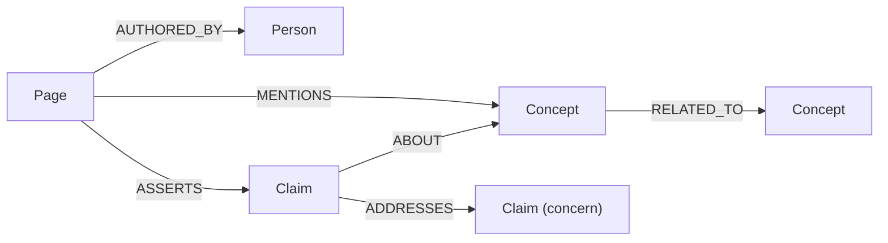
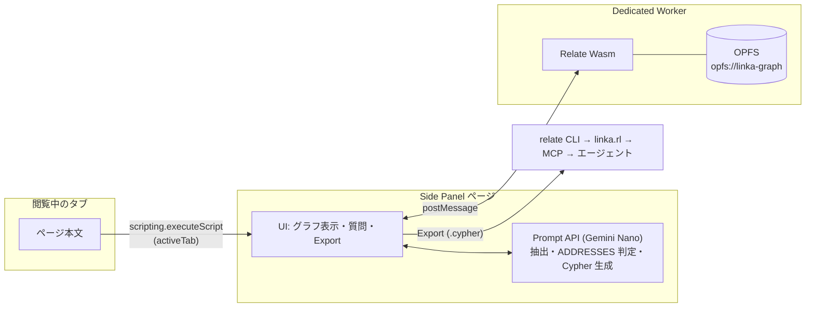

# Linka PRD — Chrome 上で育てるローカル知識グラフ

Linka は、開発者が技術調査で読んだページを Chrome のサイドパネルからクリップし、端末内の知識グラフ（Relate Wasm）として残す Chrome 拡張機能である。この文書は Relate by Neo4j Hackathon への応募作の要件の正であり、`draft.md`（Gemini と作ったたたき台）より優先する。

- 一行ピッチ（英語、提出用）：*Clip what you read in Chrome into a local knowledge graph — then hand that context to your coding agent.*
- 提出締切：2026-12-11 18:00 PST（日本時間 2026-12-12 11:00）。自分の締切は 12-10 とする
- 体制：個人、週 10 時間程度（合計 約 40 時間）
- 言語：この PRD は日本語。README・UI・デモ動画・Devpost の文面は英語

---

## 1. 目的

技術選定のために複数の記事・ドキュメント・Issue を読み比べる開発者は、今は「どの記事がどの課題を指摘し、どの記事がその解決策を示していたか」をタブとメモと記憶で抱えている。タブを閉じるとその対応関係は失われ、あとで設計判断を説明するときや、コーディングエージェントに作業を頼むときに、同じページを読み直している。

Linka は、読んだページから概念・主張（課題・解決策など）を取り出してページをまたいでつなぎ、次の 2 つをできるようにする。

1. 開発者自身が「この課題に対する解決策を書いていたのはどのページか」を、読み直さずにたどれる
2. 調べた文脈をそのままコーディングエージェント（Claude Code など）に渡せる

### 既存の手段との違い

| 手段 | できること | 足りないこと |
|---|---|---|
| Gemini in Chrome（Ask Gemini） | 今開いているページ・タブについてのクラウドでの質疑応答 | 回答はチャットで消える。ページ間の関係が構造として残らず、書き出せない |
| ブックマーク・メモアプリ | ページを残す | ページの中身どうしのつながり（課題↔解決策）は人が書くしかない |
| Linka | 選んだページから構造を取り出し、ページをまたいでつなぎ、端末内に残す | — |

### 差別化（relate-ideas との関係）

`jexp/relate-ideas` には「閲覧履歴をグラフ化するブラウザ拡張」「ブラウザ内でのエンティティ抽出」が既にある。Linka はそれらと次の点で異なる。

- 履歴を全部入れるのではなく、利用者が選んだページ・範囲だけを入れる
- **ページをまたいで「課題（concern）」と「解決策（solution）」をつなぐ**ことを中心に据える
- **人がブラウザで調べた文脈を、MCP 経由でエージェントの文脈にする**

---

## 2. 保証すること

| 観点 | 約束 |
|---|---|
| プライバシー | ページ本文・抽出結果・グラフは端末の外へ送信しない。外部 API・自前サーバーを使わない（Gemini Nano のモデル取得を除く） |
| 永続性 | クリップした内容は、サイドパネルや Chrome を閉じても残り、次に開いたとき同じグラフが表示される |
| 重複 | 同じ URL を二度クリップしても Page は 1 つ。同じ名前の Concept は 1 つにまとまる（正規化規則は §5） |
| 再クリップ | 同じ URL を再クリップすると、そのページ由来の Claim と関係は新しい抽出結果で置き換わり、古いものは残らない |
| 整合性 | 抽出やグラフ書き込みが途中で失敗したら、そのクリップは「失敗」と表示し、既存のグラフは壊さない（§4 UC1 の例外フロー） |
| 読み取り専用の質問 | 質問（UC3）はグラフを変更しない |
| 点検可能性 | グラフの内容を Cypher として書き出せ、Relate CLI で `.rl` ファイルにして中身を確認できる |
| 可観測性 | AI（Gemini Nano）の状態、クリップの成否、質問のために生成された Cypher を画面に表示する |
| 動作保証のない環境 | Gemini Nano が使えない環境でも、同梱データのグラフ表示・定型の質問・書き出し・サンプルページのクリップは動く |

## 3. 保証しないこと

- **閲覧履歴の自動収集はしない。** 利用者が明示的にクリップしたものだけを扱う（ノイズとプライバシーのため）
- **抽出の正確さは保証しない。** 抽出結果は小型のオンデバイスモデルによる推定で、誤りがありうる。手で直す編集 UI も MVP では作らない
- **複数ウィンドウでの同時利用はしない。** Relate の OPFS ストアは排他ロックのため、2 つ目のウィンドウのパネルではエラーを表示するだけ
- **モバイル、Chrome 以外のブラウザ、Chrome 138 未満は対象外**
- **端末間の同期はしない。** 持ち出しは書き出し（UC4）で行う
- **Neo4j / Aura との同期はしない。** 書き出した Cypher は他でも使えるが、その手順は扱わない
- **外部 LLM API へのフォールバックはしない。** 「端末の外へ送らない」と矛盾するため
- **ベクトル検索・全文検索 index、主張の矛盾検出（CONTRADICTS）は MVP に入れない**（§9）

## 4. 動かせない前提

| 種類 | 前提 | 出どころ |
|---|---|---|
| ハッカソン | 2026-11-11 以降に作り始めた新規プロジェクトであること。公開 GitHub リポジトリに topic `relate` を付け、結果発表まで公開を保つこと | Official Rules §3 |
| ハッカソン | 審査員が質問せずに clone → 実行 → グラフを確認できること。永続化されたストアを点検できること | Overview の Requirements |
| Relate Wasm | `@relate/relate-wasm`（v1.0.x）。永続化できるのは OPFS（`opfs://<name>`）だけで、**dedicated worker の中で開く必要がある**。`.rl` ファイルは読めない。ストアの import/export API は無い | relate リポジトリ `docs/api/wasm/spec.md`, ADR-0145 |
| Relate Wasm | `execute` は同期で、結果は JSON 文字列。エラーは例外でなく `error` に返る。トランザクション API は無い。panic 後のインスタンスは使えない | 同上 |
| Relate Wasm | 同じ OPFS ストアを開けるのは同時に 1 か所だけ（`storage locked`） | ADR-0145 |
| Prompt API | Chrome 138 以降の拡張機能で利用可能。**Web Worker からは使えない。** 対応言語は en / ja / es / de / fr | developer.chrome.com/docs/ai/prompt-api |
| Prompt API | 必要環境：空きディスク 22GB 以上、VRAM 4GB 超 または RAM 16GB 以上。審査員の環境の 2〜4 割では動かないと見込む | 同上（割合は推定） |
| Prompt API | コンテキストは数千トークン程度（実測で確かめる）。長い記事は分割が必要 | 推定。`session.contextWindow` で実測 |

---

## 5. 扱う概念（グラフモデル）

draft のモデルを引き継ぎ、重複と再クリップの扱いを足す。

| ノード | プロパティ | 識別の仕方（MERGE のキー） |
|---|---|---|
| `Page` | `url`, `title`, `summary`, `clippedAt`, `source`（`page` / `selection` / `sample`） | `url`（フラグメントと `utm_*` などの追跡パラメータを除いて正規化） |
| `Concept` | `key`, `name`（表示名）, `category` | `key` = 名前を小文字化・前後空白除去・記号の揺れ（`Web Assembly`/`WebAssembly` 等）を同梱の別名表で寄せたもの |
| `Person` | `name` | `name` を正規化したもの |
| `Claim` | `id`, `statement`, `type`（`benefit` / `concern` / `solution` / `fact`） | `id` = 正規化 URL ＋ 文のハッシュ |

- `ADDRESSES` は「あるページの solution が、**別のページ**の concern を解決する」場合だけ張る。同じページ内では張らない
- 再クリップでは、そのページが `ASSERTS` する Claim（と、それに付いた `ABOUT`・`ADDRESSES`）と `MENTIONS` を消してから入れ直す。Concept と Person は他のページが参照しうるので消さない
- 選択範囲のクリップは、同じ URL の Page に Claim を**追加**する（ページ全体の Claim は消さない）

---

## 6. ユースケース

利用者は「技術調査をする開発者」。UC4 だけは、利用者が使うコーディングエージェントも登場する。

### UC1 読んでいるページを記憶する

- 事前条件：サイドパネルが開いていて、グラフのストアが使える
- 主フロー：
  - 利用者が「Clip this page」を押すと、今のタブのタイトル・URL・本文（主要部分のみ）が読み取られる
  - 本文から summary・Concept・Person・Claim が抽出され、グラフに入る
  - サイドパネルのグラフに、新しいノードと関係が追加表示される。既存の同名 Concept には新しいページからの線がつながる
  - 続けて UC2 が走る
- 代替フロー：
  - 右クリックメニュー「Add selection to Linka」で、選択範囲だけをクリップできる（サイドパネルが閉じていれば開く）
  - 同じ URL を再クリップすると、そのページ由来の内容が置き換わる（§5）
  - 本文が長い場合は分割して抽出し、結果をまとめる
- 例外フロー：
  - Gemini Nano が使えない（`unavailable`）：同梱サンプルの URL なら事前抽出済みデータで記憶する。それ以外は「この環境では AI 抽出が使えない」と理由を表示し、グラフを変更しない
  - モデルのダウンロード中（`downloadable` / `downloading`）：進捗を表示し、終わるまでクリップを受け付けない
  - `chrome://` などスクリプトを実行できないページ、本文が取れないページ：理由を表示し、グラフを変更しない
  - 抽出結果が期待する形でない：1 回だけやり直し、それでも駄目なら失敗を表示してグラフを変更しない
  - グラフへの書き込みが途中で失敗：そのページ由来の書きかけを消し、失敗を表示する
  - 抽出中に同じページのクリップがもう一度要求された：先の処理が終わるまで受け付けない
- 事後条件：
  - グラフに、そのページの Page が 1 つだけあり、抽出された Concept・Claim とつながっている
  - サイドパネルと Chrome を閉じて開き直しても、同じ内容が表示される
  - 他のページ由来の Claim は変わっていない

### UC2 ページをまたぐ課題と解決策をつなぐ

- 事前条件：UC1 で新しい Claim が入った
- 主フロー：
  - 新しいページの solution と、既存の**別ページ**の concern のうち同じ Concept を持つものを候補として集める
  - 候補の組ごとに「この solution はこの concern を解決するか」を判定し、該当する組に `ADDRESSES` を張る
  - 新しくつながった組を「New connections」としてサイドパネルに表示し、グラフ上で強調する
- 代替フロー：
  - 新しいページの concern に対しても、既存の solution から同様に候補を集める
  - 候補が無ければ何もせず、「つながりは見つからなかった」と表示する
- 例外フロー：
  - Gemini Nano が使えない：UC2 は行わず、UC1 の結果だけを残す
  - 判定が失敗した：`ADDRESSES` を張らずに終える（UC1 の結果は残す）
- 事後条件：
  - `ADDRESSES` は異なるページの Claim の間にだけ存在する
  - UC1 で入った Page・Concept・Claim は変わっていない

### UC3 グラフに自由文で質問する

- 事前条件：グラフに 1 ページ以上ある
- 主フロー：
  - 利用者が英語で質問を入力する（例：*Which pages propose solutions to the concerns about WebAssembly memory?*）
  - グラフの形（ラベル・関係・プロパティ）を前提として、質問から Cypher が生成される
  - 生成された Cypher と結果の一覧（ページへのリンク付き）が表示され、結果に含まれるノードと関係がグラフ上で強調される
  - 結果のページノードを押すと、そのページが新しいタブで開く
- 代替フロー：
  - 定型の質問チップ（3〜5 個。例：*Concerns and their solutions*, *Pages connected through a concept*, *Most mentioned concepts*）を押すと、生成を経ずに同じ形で結果が出る
  - 生成された Cypher が文法エラーになったら、Relate が返すエラー文を添えて作り直させる（最大 2 回）
- 例外フロー：
  - 生成された Cypher に書き込み（`CREATE` / `MERGE` / `SET` / `DELETE` / `REMOVE` / `FOREACH` / `LOAD CSV` など）が含まれる：実行せずに拒否し、その旨を表示する
  - 作り直しても実行できない：失敗を表示し、近い定型の質問チップを提示する
  - 結果が 0 件：「該当なし」と、実行した Cypher を表示する
  - 結果が多すぎる：先頭の一定件数（例：50 件）だけを表示する
  - Gemini Nano が使えない：入力欄の代わりに定型の質問チップだけを表示する
  - 質問の実行が終わらない：一定時間で打ち切り、失敗を表示する（グラフは使える状態に戻る）
- 事後条件：
  - グラフの内容は変わっていない
  - 表示された Cypher を CLI（UC4）で実行すると、同じ結果が得られる

### UC4 調べた文脈をコーディングエージェントに渡す

- 事前条件：グラフに 1 ページ以上ある。利用者の端末に Relate CLI がある
- 主フロー：
  - 利用者が「Export」を押すと、グラフ全体を再現する Cypher ファイル（`linka-export.cypher`）がダウンロードされる
  - 利用者が `relate -d linka.rl < linka-export.cypher` で単一ファイルのストアにする
  - 利用者が Relate の MCP サーバー（`relate serve --database linka.rl --mcp stdio`）をコーディングエージェントに登録する
  - エージェントに「調べた課題と解決策を踏まえて実装方針を出して」と頼むと、エージェントがグラフを問い合わせて答える
- 代替フロー：
  - MCP を使わず、`relate` CLI で直接 Cypher を実行して中身を確かめられる
- 例外フロー：
  - グラフが空：Export を押せないようにする
  - 書き出したファイルの読み込みで失敗する：README に手順と、確認済みの Relate のバージョンを書いておく
- 事後条件：
  - `linka.rl` を CLI で問い合わせると、サイドパネルと同じ件数の Page・Concept・Claim・関係が返る
  - 書き出しによってサイドパネル側のグラフは変わっていない

### UC5 初めて開いて、すぐ試す

- 事前条件：拡張機能を読み込んだ直後で、ストアが空
- 主フロー：
  - サイドパネルを初めて開くと、同梱のデモデータ（技術調査 10〜15 ページ分）が入ったグラフが表示される
  - AI の状態（Ready / Downloading x% / Not available とその理由）が表示される
- 代替フロー：
  - 「Reset to demo data」で、いつでもデモデータの状態に戻せる（確認ダイアログあり）
  - 同梱のサンプル URL 一覧から開いたページは、Gemini Nano が無くてもクリップできる（事前抽出済みのデータを使う）
- 例外フロー：
  - ストアが別ウィンドウで使用中：理由と「他のウィンドウのパネルを閉じてください」を表示する
  - ストアを開けない（OPFS が使えない等）：メモリ上のグラフで動かし、「閉じると消える」と表示する
- 事後条件：
  - 2 回目以降に開いたときは、デモデータで上書きせず、前回の状態が表示される
  - 同梱の `data/linka.rl` を CLI で問い合わせた結果と、初回に表示されるグラフが同じ内容である

---

## 7. 実装方針

要件ではなく、§4 の前提から決まる構成。詳細は実装時に決める。

- MV3。権限は `sidePanel`, `activeTab`, `scripting`, `contextMenus`, `storage`。CSP に `'wasm-unsafe-eval'`。`minimum_chrome_version: "138"`
- 構成：Vite + React + TypeScript
- Relate は Side Panel が起動する dedicated worker の中で開く。メッセージは 1 件ずつ処理する。panic（`isWasmTrap`）が起きたら worker を作り直す
- Prompt API は Side Panel ページから呼ぶ（Worker からは使えないため）。抽出と判定には `responseConstraint`（JSON Schema）を使う
- 抽出結果はコード側で、パラメータ付きの MERGE 文に変換して書き込む。質問（UC3）だけはモデルに Cypher を書かせる
- 同じ `seed/demo.cypher` を、拡張機能の初回投入（`executeScript`）と、CLI での `data/linka.rl` 生成の両方に使う。Export も同じ形式で出し、CLI でもそのまま読めるようにする

---

## 8. ハッカソン提出物の対応表

| 要件（出どころ） | 対応 | 状態 |
|---|---|---|
| 公開リポジトリと topic `relate`（Rules §3・§4、Overview） | 設定済み。`relate-neo4j-hackathon` も付ける | 設定済み |
| プロジェクトの説明：何をするか・なぜ役立つか・何と何をつなぐか（Rules §4、Overview） | Devpost に英語で書く（§1 から） | 未着手 |
| README（setup / use、指定テンプレート）（Overview） | Use case / How it uses Relate（Mode：拡張機能内は OPFS、同梱は single file。理由：Wasm で永続化できるのは OPFS だけで、審査員が点検できるよう同じ内容を `.rl` でも同梱）/ Setup and run / Where the data lives | 未着手 |
| 永続化されたストア（Overview） | `data/linka.rl`（`seed/demo.cypher` から CLI で生成） | 未着手 |
| Relate が実際に動いているコード（Overview） | 拡張機能本体 | 未着手 |
| デモ（2 分以内、ログイン不要で見られる）（Rules §4、Overview） | YouTube 限定公開などで 1 分 30 秒〜2 分 | 未着手 |
| 使った Relate の機能・サードパーティツール・AI ツールの申告（Rules §3・§4） | Relate（Wasm・OPFS・Cypher・CLI・MCP）、使用ライブラリ、Gemini Nano（実行時）、Claude Code と Gemini（開発時）を README と Devpost に書く | 未着手 |
| 2026-11-11 以降の新規作成（Rules §3） | 最初のコミットの日付で示す。流用したコードがあれば明記する | 遵守 |
| ライセンス（Rules §3、推奨） | MIT | 未着手 |

## 9. 審査基準への対応

| 基準（Overview の配点） | 応え方 |
|---|---|
| Relate and connected context（30） | ページをまたぐ `ADDRESSES` と多段の経路の質問を中心に置き、結果の経路をグラフ上で強調する。OPFS での永続化、`.rl` と MCP での連携まで Relate の機能を通して使う |
| Functionality and completeness（25） | Nano が無い環境でも、デモデータ・定型の質問・サンプルのクリップ・Export が動く（UC5） |
| Usefulness（20） | 「技術選定の調査 → エージェントへの引き継ぎ」という一続きの流れをデモで見せる |
| Documentation and reproducibility（15） | `npm install && npm run build` → `chrome://extensions` で `dist/` を読み込む、の手順だけで UC5 まで届くようにする。CLI での `.rl` の確認手順も載せる |
| Creativity（10） | 課題↔解決策のつながりと、人の調査をエージェントの文脈にするという使い方 |

## 10. MVP の範囲

| MVP | 後回し（時間が余ったら） |
|---|---|
| UC1〜UC5 | 全文検索 index によるページ検索（Wasm での動作が未確認） |
| | ベクトル検索（Chrome に組み込みの埋め込みモデルが無い） |
| | Claim の矛盾検出（`CONTRADICTS`） |
| | 抽出結果の手動編集 |
| | 日本語ページの抽出（Nano は ja に対応しているが、デモと審査は英語で行う） |

## 11. マイルストーン

| 週 | 期間 | やること | 終わりの判定 |
|---|---|---|---|
| W1 | 〜11/22 | 技術スパイク：拡張機能の Worker で Relate Wasm と OPFS が動くか／`responseConstraint` で抽出できるか／Nano が書く Cypher の成功率をデモデータ相手の質問 10 問で測る | 3 つとも結果が出て、§12 の未決事項が決まっている |
| W2 | 〜11/29 | UC1 と UC5（クリップ → 抽出 → 書き込み → グラフ表示、デモデータ投入） | 記事 3 本をクリップして、再起動後も残っている |
| W3 | 〜12/6 | UC2・UC3・UC4 | デモの筋書きを最初から最後まで通せる |
| W4 | 〜12/10 | `data/linka.rl`、README、動画、Devpost 提出 | 提出済み、topic と公開状態を確認済み |

W1 のスパイクで Nano の Cypher 生成の成功率が低い（10 問中 5 問未満）場合は、UC3 の主フローを定型の質問チップにし、自由文は補助に格下げする。

## 12. リスクと対策

| リスク | 対策 |
|---|---|
| 審査員の環境で Gemini Nano が動かない | UC5 のデモデータ・サンプルのクリップ・定型の質問で、Nano 無しでも採点できるようにする。動画では Nano が動く環境での一連の流れを見せる |
| Nano が書く Cypher が壊れる | グラフの形をプロンプトに入れる、Relate のエラー文で作り直す、書き込みを拒否する、定型の質問へ逃がす |
| 長い記事がコンテキストに入らない | 本文の主要部分だけを取り、分割して抽出する |
| Relate 1.0.x の変更（11/11 公開、更新が速い） | バージョンを固定し、README に確認済みのバージョンを書く |
| OPFS のロックで 2 つ目のウィンドウが使えない | 保証しない（§3）。理由を表示する |
| 拡張機能のページから OPFS の Worker が使えない | **解消（2026-11-15）。** `spikes/relate-opfs` で、拡張機能のページから起動した dedicated worker で OPFS に書き込めること、ページの開き直し・ブラウザの再起動後も残ること、2 か所目は `storage locked` になることを確認した（Playwright の Chromium 159 での自動確認に加え、Chrome 157 の実際のサイドパネルでも、閉じて開き直したあと・Chrome を再起動したあとに件数が変わらないことを手動で確認した） |

## 13. 未決事項（W1 のスパイクで決める）

- グラフ表示のライブラリ（`react-force-graph-2d` か `cytoscape.js` か）
- 本文抽出の方法（Readability 系のライブラリか、自前の簡易抽出か）
- 分割の大きさ（`session.contextWindow` の実測値から）
- 質問の書き込み拒否を、キーワード検査だけにするか、`EXPLAIN` の実行計画も見るか
- Concept の別名表の持ち方
