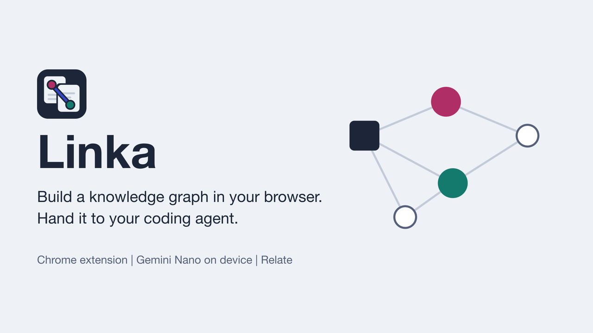
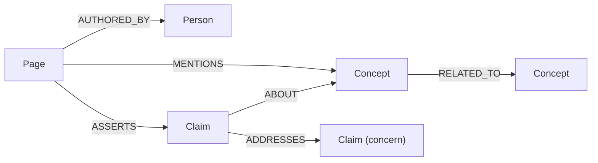

<p align="center">
  
</p>

<h1 align="center">Linka</h1>

<p align="center">
  Build a knowledge graph from the pages you read, right in Chrome.<br>
  Ask it questions, then hand it to Claude Code or Codex over MCP.<br>
  Runs on-device with Gemini Nano and <a href="https://github.com/relatedb/relate">Relate</a>.
</p>

<p align="center">
  <a href="https://github.com/sumiredc/linka/actions/workflows/ci.yml"></a>
  <a href="LICENSE"></a>
</p>

<p align="center">
  <a href="https://youtu.be/ZYyIQFN0fSY"></a><br>
  <a href="https://youtu.be/ZYyIQFN0fSY">Demo video (1:43)</a>
</p>

Linka is a Chrome extension built for the Relate by Neo4j Hackathon.

## Use case

Before you adopt a technique, you read about it: engineering blog posts, docs, issues and comparisons. One page raises a concern; another page, often by someone else, proposes a fix. You want your coding agent to build with what you read, but handing it a pile of links loses which page answers which concern.

Linka turns the pages you clip into a graph. The relationships that matter:

- **A solution on one page addresses a concern on another** (`Claim -[:ADDRESSES]-> Claim`, across pages). Gemini Nano suggests these links as you clip.
- **Pages share concepts** (`Page -[:MENTIONS]-> Concept`, `Claim -[:ABOUT]-> Concept`), so you can find every concern about OPFS, whichever page it came from.

You ask the graph questions in Chrome's side panel, and your coding agent reads the same graph over MCP, so it plans with the concerns and solutions you collected. Everything stays on your device: there is no server, and Linka stores only the pages you clip.

## How it uses Relate

- **Mode:** single file. The repository includes `data/linka.rl`, and the graph you hand to your agent is a `linka.rl` file in your project folder. Inside the extension, Relate Wasm persists the graph to OPFS.
- **Why this mode:** In the browser, OPFS is the only storage Relate Wasm supports, and only from a dedicated worker, so an offscreen document owns the store and the popup and side panels send it requests. To leave the browser, the same Cypher becomes a single-file store that the Relate CLI can query and serve to a coding agent with `relate serve --read-only --mcp stdio`. `data/linka.rl` is that format, so you can inspect a persisted Linka graph with the CLI without loading the extension.
- **What the graph models:** pages, the concepts they mention, their authors, and the claims they make (concerns, solutions, benefits and facts), with `ADDRESSES` links from a solution to the concern it solves on another page.



The code builds every Cypher statement; the model never writes one. Extraction results become parameterized `MERGE` statements, and for a question Gemini Nano only picks one of nine query kinds and its target. The side panel shows the Cypher it ran.

## Setup and run

There are two ways to try Linka. The first needs only the Relate CLI; the second runs the extension in Chrome.

### Look at a Linka graph with the Relate CLI

`data/linka.rl` holds a graph of 15 research pages on local-first, offline web storage. With the [Relate CLI](docs/relate-cli.md) 1.0.x installed:

```sh
export DO_NOT_TRACK=1   # turns off the CLI's usage metrics

# Nodes by label
relate query --read-only -d data/linka.rl "MATCH (n) RETURN labels(n)[0] AS label, count(*) AS count ORDER BY label"

# Which page's solution addresses which page's concern
relate query --read-only -d data/linka.rl "MATCH (sp:Page)-[:ASSERTS]->(:Claim)-[:ADDRESSES]->(:Claim)<-[:ASSERTS]-(cp:Page) RETURN DISTINCT cp.title AS concern_page, sp.title AS solution_page"
```

The first query lists 15 `Page`, 29 `Concept`, 9 `Person` and 48 `Claim` nodes. Always pass `--read-only`: without it, even a read rewrites the file.

### Run the extension

**Prerequisites**

- Desktop Chrome 138 or later, with Gemini Nano available. Per [Chrome's Prompt API docs](https://developer.chrome.com/docs/ai/prompt-api), Gemini Nano needs Windows 10/11, macOS 13+, Linux or a Chromebook Plus; at least 22 GB of free disk space; and either a GPU with more than 4 GB of VRAM or 16 GB of RAM with 4 or more CPU cores.
- Node.js 26.13.1 and npm 12.2.2. The versions are pinned in `package.json`, and `npm ci` fails on others. [Volta](https://volta.sh/) picks them automatically.

**Build and load**

```sh
git clone https://github.com/sumiredc/linka.git
cd linka
npm ci
npm run build
```

1. Open `chrome://extensions`, turn on **Developer mode**, click **Load unpacked** and choose the `dist/` folder.
2. Pin Linka to the toolbar (puzzle-piece icon → pin).

Chrome lists "Read your browsing history" among Linka's permissions. It comes from the `tabs` permission, which Linka uses to put a ✓ on its icon for pages you have already clipped; Linka does not collect history.

**Clip your first page**

1. Open an article in English, such as a blog post about a technique you are considering, and click the Linka icon. If Gemini Nano is not on your device yet, its download starts here and the popup shows the progress.
2. Clipping runs: read the page → extract concepts and claims → save to the graph → find connections to other pages. You can close the popup; clipping continues.
3. Open Chrome's side panel and choose **Linka**. The page, its concepts and claims appear in the graph; click a node to see its details. Clip a few related pages to see suggested connections between them.
4. Ask a question below the graph and press ⌘/Ctrl + Enter, for example *What concerns are there about OPFS?* or *Which solutions address concerns about offline support?* The side panel shows the Cypher it ran and highlights the answer in the graph.

**Hand it to your coding agent**

In the side panel, choose **… → Export** and save `linka-export.cypher` in your project folder. Then, in that folder:

```sh
DO_NOT_TRACK=1 relate query --jsonl -d linka.rl < linka-export.cypher
claude mcp add linka -e DO_NOT_TRACK=1 -- relate serve --database "$PWD/linka.rl" --read-only --mcp stdio
```

and ask Claude Code: *Use the linka graph to suggest an implementation plan based on the concerns and solutions I researched.* For Codex, Windows and troubleshooting, see [Use Linka with your coding agent](docs/agent-handoff.md).

## Where the data lives

| Data | Location |
|---|---|
| The graph you build | OPFS of the extension's origin (`opfs://linka-graph`), in your Chrome profile. Removing the extension removes it. **… → Clear graph** empties it. |
| The persisted store in this repository | `data/linka.rl`, built from `seed/demo.cypher` with `npm run store`. The extension starts with an empty graph and does not load it. |
| What you hand to your agent | `linka-export.cypher` and `linka.rl` in your project folder |

## Privacy

Page text, extraction results and the graph stay on your device. Extraction and questions run on Gemini Nano in Chrome; there is no Linka server and no call to an external API. The only network traffic Linka causes is Chrome downloading the Gemini Nano model.

## Limitations

- Extraction is an estimate by a small on-device model and can be wrong, and there is no editor for the graph.
- Suggested connections can be wrong too. On 21 labeled pairs, Gemini Nano agreed on 13, so Linka says a solution *may* address a concern.
- Clipping and questions need Gemini Nano; there is no fallback to a cloud model.
- English pages work best. Desktop Chrome only.

## Documentation

- [Using Linka](docs/usage.md): the side panel, Gemini Nano, clipping and asking in detail, and the persisted store
- [Use Linka with your coding agent](docs/agent-handoff.md): every step, for Claude Code and Codex, on macOS, Linux and Windows
- [Relate CLI](docs/relate-cli.md): installing it, and turning off its telemetry
- [Development](docs/development.md): scripts, source layout, rebuilding `data/linka.rl`, logs
- [Declarations](docs/declarations.md): Relate features, third-party libraries and AI tools used

## License

[MIT](LICENSE)
