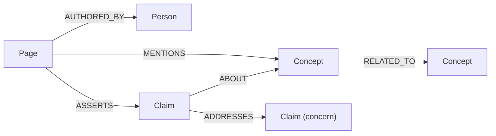

# Linka

*Clip what you read in Chrome into a local knowledge graph — then hand that context to your coding agent.*

Linka is a Chrome extension (Manifest V3). When you clip a page from the toolbar, Gemini Nano on your device extracts its summary, concepts, authors and claims (concerns, solutions, benefits, facts), and Linka stores them in a [Relate](https://github.com/relatedb/relate) graph inside the browser. Pages are linked through shared concepts, and a solution on one page is linked to the concern it addresses on another page. You can browse the graph in the side panel, ask it questions, and export it so that Claude Code or Codex can query it over MCP.

Built for the Relate by Neo4j Hackathon. MIT licensed.

Demo video (1:43): https://youtu.be/ZYyIQFN0fSY

## Use case

When you compare articles, docs and issues to choose a technology, you keep track of "which page raised this concern, and which page had the fix" in tabs, notes and memory. Close the tabs and that mapping is gone; later you reread the same pages to explain a decision or to brief a coding agent.

Linka keeps that mapping as a graph:

- You trace from a concern to the pages that propose solutions to it, without rereading them.
- Your coding agent reads the same graph over MCP, so it plans with the concerns and solutions you researched.

Unlike Gemini in Chrome or a bookmark manager, Linka keeps the structure between pages (`Claim -[:ADDRESSES]-> Claim` across pages), keeps it on your device, and exports it. It only stores pages you clip; it never collects browsing history.

## How it uses Relate

| Where | Mode | Why |
|---|---|---|
| Inside the extension | `@relate/relate-wasm` 1.0.1 persisted to **OPFS** (`opfs://linka-graph`), opened in a dedicated worker owned by the extension's offscreen document | Relate Wasm can persist only to OPFS, and only from a dedicated worker. A service worker cannot start one, so a single offscreen document owns the store and the popup and every side panel send it requests (one OPFS store can be open in only one place at a time). |
| Bundled with the repository | `data/linka.rl`, a **single-file store** built with the Relate CLI | Judges can inspect the persisted graph with the CLI without loading the extension. It holds a demo graph of 15 research pages built from `seed/demo.cypher`; the extension itself starts with an empty graph. |
| Handing off to an agent | `relate query` turns the extension's Cypher export into a single-file store; `relate serve --read-only --mcp stdio` exposes it to Claude Code or Codex | The agent sees only `read_cypher` and `get_schema`, and the file is not modified. |

The graph model:



Extraction results are written with parameterized `MERGE` statements built by the code, never by the model. Questions work the same way: Gemini Nano only picks one of nine query kinds and its target, if the kind needs one (one or two concepts, a page from your graph, or a number); the Cypher for each kind is fixed in the code, and the side panel shows the Cypher it ran.

## Setup and run

### Requirements

- Chrome 138 or later on desktop
- Node.js 26.13.1 and npm 12.2.2. The versions are pinned in `package.json` (`engines` and `volta`), and `.npmrc` sets `engine-strict=true`, so other versions fail `npm ci`. With [Volta](https://volta.sh/) installed, the right versions are picked automatically.
- Gemini Nano on your device, for clipping pages and asking questions (see [Gemini Nano](#gemini-nano))
- Optional, for inspecting `data/linka.rl` and handing the graph to an agent: the Relate CLI 1.0.x (see [Relate CLI](#relate-cli))

### Build and load the extension

```sh
git clone https://github.com/sumiredc/linka.git
cd linka
npm ci
npm run build
```

1. Open `chrome://extensions` and turn on **Developer mode**.
2. Click **Load unpacked** and choose the `dist/` folder.
3. Loading unpacked shows no permission prompt. The extension's **Details** page lists its permissions, including "Read your browsing history", which comes from the `tabs` permission. Linka needs it to read the URL of a tab when you switch tabs or a tab navigates, so it can put the ✓ badge on its icon for pages you have already clipped. Linka does not collect history.
4. Pin Linka to the toolbar (puzzle-piece icon → pin).

### First run

Open Chrome's side panel (the side panel button in the toolbar) and choose **Linka**. The graph starts empty, and the side panel tells you how to clip your first page. Clicking the Linka icon itself clips the current page (see [Use](#use)); its popup offers **Open side panel** after a clip. The header shows the AI status: `AI ready`, `Downloading AI`, or not available with the reason.

The next time you open it, the side panel shows your graph as you left it. **… → Clear graph** deletes every page you clipped, after a confirmation.

### Gemini Nano

Linka extracts and connects pages, and answers questions, with Gemini Nano through Chrome's Prompt API. Without it, you cannot clip pages or ask questions; you can still browse, export and clear a graph you already have.

Per [Chrome's Prompt API docs](https://developer.chrome.com/docs/ai/prompt-api), Gemini Nano needs:

- A desktop OS: Windows 10/11, macOS 13+, Linux, or ChromeOS on a Chromebook Plus (not Android or iOS)
- At least 22 GB of free disk space on the volume with your Chrome profile
- Either a GPU with more than 4 GB of VRAM, or a CPU with 16 GB of RAM and 4 or more cores

It may also be disabled by an enterprise policy (not verified).

To get the model, open the Linka popup (click the Linka icon on any page). If the model is not on your device yet, its download starts there, and the popup and the side panel show the progress. When it finishes, the side panel header shows `AI ready`. If it shows that AI is not available, the reason next to it says why.

### Use

1. **Clip a page.** Open an article and click the Linka icon. Clipping starts right away: read the page → extract concepts and claims → save to the graph → find connections to other pages. You can close the popup; clipping continues. When it finishes, the popup lists the counts and the suggested connections, and the icon shows that the page is clipped. Clicking the icon on a clipped page offers **Clip again** (replaces what was extracted from that page) and **Open side panel**. Extraction asks Gemini Nano for English input and output, so English pages work best.
2. **Browse the graph.** In the side panel, click a node to see its details.
3. **Ask a question.** Type an English question and press ⌘/Ctrl + Enter. For example, after clipping a few pages about offline web storage:
   - What concerns are there about OPFS?
   - Which solutions address concerns about offline support?
   - Which pages mention both OPFS and Web Worker?

   The side panel shows the executed Cypher and the results, and highlights them in the graph. Click a page in the results to open it in a new tab. If a question does not fit a supported type, it lists the types and the concepts in your graph instead.
4. **Hand it to your agent.** See [Use with your coding agent](#use-with-your-coding-agent).

## Use with your coding agent

Everything happens in the project folder you work on with your agent, so each project gets its own graph.

Before you start, **install the Relate CLI** (see [Relate CLI](#relate-cli)). **… → Use with your agent** in the side panel shows the same steps as below, with copy buttons.

1. **Save the export in your project folder.** In the side panel, choose **… → Export**. Chrome asks where to save `linka-export.cypher`: choose your project folder, and replace the old file if there is one. Export is disabled while the graph is empty. If Chrome downloads the file instead of asking, move it into your project folder.

   To keep the export and `linka.rl` out of git, add them to your `.gitignore`.

2. **Make a Relate file.** In a terminal, in your project folder, run:

   ```sh
   DO_NOT_TRACK=1 relate query --jsonl -d linka.rl < linka-export.cypher
   ```

   Windows (PowerShell):

   ```powershell
   $env:DO_NOT_TRACK=1; cmd /c "relate query --jsonl -d linka.rl < linka-export.cypher"
   ```

   PowerShell has no `<`, and piping the file in Windows PowerShell 5.1 can change its encoding, so `cmd` passes the file as it is.

   Run it again after each export. The export starts by deleting everything in the store, so `linka.rl` ends up with exactly the exported graph, and pages you deleted in Linka do not remain. On a new file, Relate notes that statement 1 changed nothing; that is expected.

3. **Register it as a read-only MCP server.** Do this after step 2 succeeds; otherwise the server fails to start. Run it in your project folder: `$PWD` is expanded by your shell, so the agent's configuration gets an absolute path and works even when you start the agent in a subfolder.

   Claude Code:

   ```sh
   claude mcp add linka -e DO_NOT_TRACK=1 -- relate serve --database "$PWD/linka.rl" --read-only --mcp stdio
   ```

   Registers linka for this project only (the default `local` scope). Check it with `claude mcp list`.

   Claude Code on Windows (PowerShell):

   ```powershell
   claude mcp add linka -e DO_NOT_TRACK=1 '--' relate serve --database "$PWD\linka.rl" --read-only --mcp stdio
   ```

   The `--` is quoted because Windows PowerShell 5.1 drops a bare `--` before passing the arguments on.

   Codex:

   ```sh
   codex mcp add linka --env DO_NOT_TRACK=1 -- relate serve --database "$PWD/linka.rl" --read-only --mcp stdio
   ```

   Codex on Windows (PowerShell):

   ```powershell
   codex mcp add linka --env DO_NOT_TRACK=1 '--' relate serve --database "$PWD\linka.rl" --read-only --mcp stdio
   ```

   Writes `[mcp_servers.linka]` to `~/.codex/config.toml`, so every project sees it; running it in another project switches linka to that project's file. Restart Codex and run `/mcp` to see linka.

   If `/mcp` shows linka as failed, check that `ls linka.rl` in your project folder lists the file. If not, run step 2.

   With `--read-only`, the agent sees only `read_cypher` and `get_schema`, and the file is not modified. Without it, the agent also gets `write_cypher` and can change the graph.

4. **Ask your agent.**

   ```text
   Use the linka graph to suggest an implementation plan based on the concerns and solutions I researched.
   ```

To check the file without an agent, run this in your project folder:

```sh
DO_NOT_TRACK=1 relate query --read-only -d linka.rl "MATCH (p:Page) RETURN p.title AS title"
```

On Windows (PowerShell):

```powershell
$env:DO_NOT_TRACK=1; relate query --read-only -d linka.rl "MATCH (p:Page) RETURN p.title AS title"
```

The macOS and Linux commands were checked on macOS with Relate CLI 1.0.1. The Windows commands were not run on Windows.

## Where the data lives

| Data | Location |
|---|---|
| Your graph | OPFS of the extension's origin (`opfs://linka-graph`), in your Chrome profile. Removing the extension removes it. If OPFS cannot be used, the side panel says the graph is kept in memory and disappears when closed. |
| Clip-recovery bookkeeping | `localStorage` of the extension's offscreen document |
| Demo data, for `data/linka.rl` and the tests | `seed/demo.json` → `seed/demo.cypher` (generated with `npm run seed`). Not in the extension |
| Bundled store | `data/linka.rl`, built from `seed/demo.cypher` with `npm run store` |
| Your export | `linka-export.cypher` and `linka.rl` in the project folder you chose, if you follow the steps above |

## The bundled store: `data/linka.rl`

`data/linka.rl` (a single file of about 116 KB) holds the demo graph from `seed/demo.cypher`, which the extension does not load (verified with Relate CLI 1.0.1: 15 `Page`, 29 `Concept`, 9 `Person`, 48 `Claim`; 90 `ABOUT`, 10 `ADDRESSES`, 48 `ASSERTS`, 9 `AUTHORED_BY`, 64 `MENTIONS`, 25 `RELATED_TO`). Always open it with `--read-only`: without it, even a read rewrites the file.

```sh
export DO_NOT_TRACK=1

# Count nodes by label
relate query --read-only -d data/linka.rl "MATCH (n) RETURN labels(n)[0] AS label, count(*) AS count ORDER BY label"

# Count relationships by type
relate query --read-only -d data/linka.rl "MATCH ()-[r]->() RETURN type(r) AS type, count(*) AS count ORDER BY type"

# Which page's solution addresses which page's concern
relate query --read-only -d data/linka.rl "MATCH (sp:Page)-[:ASSERTS]->(:Claim)-[:ADDRESSES]->(:Claim)<-[:ASSERTS]-(cp:Page) RETURN DISTINCT cp.title AS concern_page, sp.title AS solution_page"
```

To rebuild it after changing `seed/demo.json`:

```sh
npm run seed   # seed/demo.json -> seed/demo.cypher
npm run store  # seed/demo.cypher -> data/linka.rl (needs Relate CLI 1.0.x on PATH)
```

The rebuilt file is not byte-identical to the previous one even when the seed is unchanged, so rebuild it only when the seed changes.

## Relate CLI

Install it with the official installer, which checks the signature and checksum and puts `relate` in `~/.local/bin` (no sudo):

```sh
curl -sSfL https://relatedb.ai/install.sh | bash
relate --version
```

The installer always installs the latest release. Linka was checked with **Relate CLI 1.0.1** (the same version as the bundled `@relate/relate-wasm`) on macOS (arm64); to pin that version, download the binary for your platform (such as `relate-darwin-arm64`) from the [`v1.0.1` release](https://github.com/relatedb/relate/releases). Other platforms were not checked.

On Windows, the installer above is not available. Download `relate-windows-amd64.exe` from the [`v1.0.1` release](https://github.com/relatedb/relate/releases), rename it to `relate.exe`, and put it in a folder on your `PATH`.

### Turning off the CLI's telemetry

The Relate CLI sends anonymous usage metrics by default. Every command in this README sets `DO_NOT_TRACK=1`, which turns them off for that command. To turn them off permanently:

```sh
relate telemetry off
relate telemetry status
```

## Privacy

- Page text, extraction results and the graph stay on your device. Extraction and questions run on Gemini Nano in Chrome; there is no Linka server and no call to an external API.
- The only network traffic Linka causes is Chrome downloading the Gemini Nano model.
- Linka stores only the pages you clip. It does not collect browsing history.
- The Relate CLI's telemetry is separate from the extension; see [Turning off the CLI's telemetry](#turning-off-the-clis-telemetry).

## Limitations

- Extraction is an estimate by a small on-device model and can be wrong. There is no editor for the graph.
- Suggested connections between pages can be wrong too. On 21 labeled pairs from the demo graph, Gemini Nano agreed on 13 and called about half of the unrelated pairs connected (measured on `dev.html` → **UC2 judge accuracy**).
- Clipping and questions need Gemini Nano; there is no fallback to a cloud model.
- No sync between devices or with Neo4j / Aura; export is the way out.
- Desktop Chrome 138+ only.

## Development

```sh
npm test            # Vitest, including tests against a real in-memory Relate
npm run typecheck   # tsc
npm run lint        # Biome (CI runs `npx biome ci .`)
npm run build       # dist/, the extension to load or ship
npm run build:dev   # dist/ with the development page dev.html
npm run dev         # like build:dev, and rebuild on change; reload the extension on chrome://extensions
```

The source is under `src/`, one folder per place it runs: `background/` (service worker), `offscreen/` (the Relate database and Gemini Nano), `popup/`, `sidepanel/`, `content/` (reads the page) and `shared/`.

### Manual checks on `dev.html`

`dev.html` is only in development builds: run `npm run build:dev` or `npm run dev`, reload the extension, and open `chrome-extension://<extension-id>/dev.html` in a tab (it is not linked from the UI; labels are in Japanese). `npm run build` leaves it out, because its console can write to your graph. It has a Cypher console on the extension's real database (writes there change your graph), an extraction check and Gemini Nano checks.

### Offscreen document logs

Timings of extraction, `ADDRESSES` judging and questions are logged in the offscreen document's console: open `chrome://extensions` → Linka → **Inspect views: offscreen.html**.

**Do not open `offscreen.html` in a tab.** That page starts its own database worker, becoming a second owner of the OPFS store, which only one place can open at a time.

## Declarations

### Relate features used

- `@relate/relate-wasm` 1.0.1 in a dedicated worker: OPFS persistence (`RelateDb.open("opfs://…")`), in-memory fallback, `execute` with parameters, `executeScript` for reading the whole graph and for **Clear graph**, and `isWasmTrap` to recreate the worker after a panic
- Cypher: parameterized `MERGE`, multi-hop path queries for questions and cross-page connections
- Relate CLI: `relate query` to build `data/linka.rl` and the exported store, `--read-only` queries
- Relate MCP server: `relate serve --read-only --mcp stdio`, registered in Claude Code and Codex

### Third-party libraries

Runtime (bundled into the extension):

| Package | Version | License |
|---|---|---|
| `@relate/relate-wasm` | 1.0.1 | Apache-2.0 |
| `@mozilla/readability` | 0.6.0 | Apache-2.0 |
| `react` | 19.3.1 | MIT |
| `react-dom` | 19.3.1 | MIT |
| `react-force-graph-2d` | 1.29.2 | MIT |
| `zod` | 4.6.7 | MIT |

Development only:

| Package | Version | License |
|---|---|---|
| `@biomejs/biome` | 2.6.7 | MIT OR Apache-2.0 |
| `@types/chrome` | 0.3.7 | MIT |
| `@types/react` | 19.3.0 | MIT |
| `@types/react-dom` | 19.3.0 | MIT |
| `@vitejs/plugin-react` | 6.3.0 | MIT |
| `happy-dom` | 21.0.4 | MIT |
| `typescript` | 7.0.2 | Apache-2.0 |
| `vite` | 8.3.8 | MIT |
| `vitest` | 5.1.0 | MIT |

Licenses are taken from each package's `package.json`; transitive dependencies are not listed. Other tools: the Relate CLI 1.0.1 (Apache 2.0 binary) and Chrome's Prompt API.

### AI tools

- **Gemini Nano** (Chrome Prompt API) runs at runtime, on device, for extraction, `ADDRESSES` judging and choosing the question type.
- **Claude Code** and **Gemini** were used during development.

### New work

The project was started on or after 2026-11-11; the first commit is dated 2026-11-15. All code in this repository was written for this hackathon.

## License

[MIT](LICENSE)
