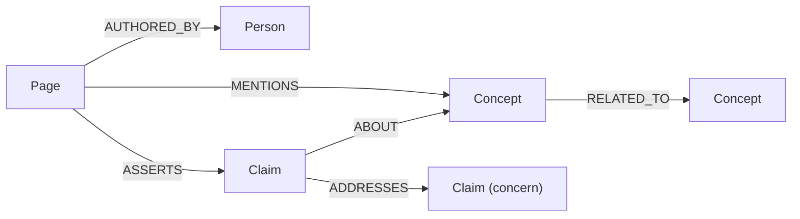

# Linka

*Clip what you read in Chrome into a local knowledge graph — then hand that context to your coding agent.*

Linka is a Chrome extension (Manifest V3). When you clip a page from the toolbar, Gemini Nano on your device extracts its summary, concepts, authors and claims (concerns, solutions, benefits, facts), and Linka stores them in a [Relate](https://github.com/relatedb/relate) graph inside the browser. Pages are linked through shared concepts, and a solution on one page is linked to the concern it addresses on another page. You can browse the graph in the side panel, ask it questions, and export it so that Claude Code or Codex can query it over MCP.

Built for the Relate by Neo4j Hackathon. MIT licensed.

## Use case

When you compare articles, docs and issues to choose a technology, you keep track of "which page raised this concern, and which page had the fix" in tabs, notes and memory. Close the tabs and that mapping is gone; later you reread the same pages to explain a decision or to brief a coding agent.

Linka keeps that mapping as a graph:

- You trace from a concern to the pages that propose solutions to it, without rereading them.
- Your coding agent reads the same graph over MCP, so it plans with the concerns and solutions you researched.

Unlike Gemini in Chrome or a bookmark manager, Linka keeps the structure between pages (`Claim -[:ADDRESSES]-> Claim` across pages), keeps it on your device, and exports it. It only stores pages you clip; it never collects browsing history.

## How it uses Relate

| Where | Mode | Why |
|---|---|---|
| Inside the extension | `@relate/relate-wasm` 1.0.1 persisted to **OPFS** (`opfs://linka-graph`), opened in a dedicated worker owned by the extension's offscreen document | Relate Wasm can persist only to OPFS, and only from a dedicated worker. A service worker cannot start one, so a single offscreen document owns the store and the popup and every side panel send it requests (one OPFS store can be open in only one place at a time). |
| Bundled with the repository | `data/linka.rl`, a **single-file store** built with the Relate CLI | Judges can inspect the persisted graph with the CLI without loading the extension. It is built from the same `seed/demo.cypher` that the extension loads on first run, so it has the same content. |
| Handing off to an agent | `relate query` turns the extension's Cypher export into a single-file store; `relate serve --read-only --mcp stdio` exposes it to Claude Code or Codex | The agent sees only `read_cypher` and `get_schema`, and the file is not modified. |

The graph model:



Extraction results are written with parameterized `MERGE` statements built by the code, never by the model. Questions work the same way: Gemini Nano only picks one of nine question types and a concept from your graph; the Cypher for each type is fixed in the code, and the side panel shows the Cypher it ran.

## Setup and run

### Requirements

- Chrome 138 or later on desktop
- Node.js 26.13.1 and npm 12.2.2. The versions are pinned in `package.json` (`engines` and `volta`), and `.npmrc` sets `engine-strict=true`, so other versions fail `npm ci`. With [Volta](https://volta.sh/) installed, the right versions are picked automatically.
- Optional, for questions and for clipping real pages: Gemini Nano (see [Without Gemini Nano](#without-gemini-nano))
- Optional, for inspecting `data/linka.rl` and handing the graph to an agent: the Relate CLI 1.0.x (see [Relate CLI](#relate-cli))

### Build and load the extension

```sh
git clone https://github.com/sumiredc/linka.git
cd linka
npm ci
npm run build
```

1. Open `chrome://extensions` and turn on **Developer mode**.
2. Click **Load unpacked** and choose the `dist/` folder.
3. Chrome warns that Linka can "Read your browsing history". This comes from the `tabs` permission, which Linka needs to read the URL of the active tab to mark already-clipped pages on its icon. Linka does not collect history.
4. Pin Linka to the toolbar (puzzle-piece icon → pin).

### First run

Click the Linka icon, then **Open side panel** (or open Chrome's side panel and choose Linka). On first run the side panel shows a demo graph of 15 pages from a technical research on local-first, offline web storage (15 pages, 29 concepts, 9 people, 48 claims, 11 cross-page `ADDRESSES` links). The header shows the AI status: `AI ready`, `Downloading AI`, or not available with the reason.

The next time you open it, the side panel shows your graph as you left it; the demo data is not loaded again. **… → Reset to demo data** brings the demo graph back (after a confirmation).

### Without Gemini Nano

Gemini Nano runs only where Chrome supports it. Per [Chrome's Prompt API docs](https://developer.chrome.com/docs/ai/prompt-api), it needs a desktop OS (Windows 10/11, macOS 13+, Linux, or ChromeOS on a Chromebook Plus; not Android or iOS), at least 22 GB of free disk space, and either a GPU with more than 4 GB of VRAM or 16 GB of RAM. It may also be disabled by an enterprise policy (not verified). The model is downloaded the first time you clip a page; the popup and the side panel show the progress.

| Feature | Without Gemini Nano |
|---|---|
| Demo graph in the side panel, node details, Reset to demo data | Works |
| Clipping the bundled sample pages | Works (uses pre-extracted data shipped with the extension) |
| Export and the agent hand-off (UC4) | Works |
| Clipping any other page | Not available. The popup says why and the graph is not changed |
| Asking the graph a question | Not available. The side panel says on-device AI is required |

The three bundled sample pages are inside the extension. Find Linka's ID on `chrome://extensions` and open one of these in a tab, then click the Linka icon:

- `chrome-extension://<extension-id>/samples/keep-offline-data.html`
- `chrome-extension://<extension-id>/samples/crdt-notes-sync.html`
- `chrome-extension://<extension-id>/samples/sqlite-worker-owner.html`

Each sample's solutions connect to concerns already in the demo graph, so the popup shows new connections.

### Use

1. **Clip a page.** Open an article and click the Linka icon. Clipping starts right away: read the page → extract concepts and claims → save to the graph → find connections to other pages. You can close the popup; clipping continues. When it finishes, the popup lists the counts and the new connections, and the icon shows that the page is clipped. Clicking the icon on a clipped page offers **Clip again** (replaces what was extracted from that page) and **Open side panel**. Extraction asks Gemini Nano for English input and output, so English pages work best.
2. **Browse the graph.** In the side panel, click a node to see its details. Click a page in the results to open it in a new tab.
3. **Ask a question** (needs Gemini Nano). Type an English question and press ⌘/Ctrl + Enter. For example:
   - What concerns are there about OPFS?
   - Which solutions address concerns about offline support?
   - Which pages mention both OPFS and Web Worker?
   - Which pages propose solutions to the concerns raised on the local-first software page?

   The side panel shows the executed Cypher and the results, and highlights them in the graph. If a question does not fit a supported type, it lists the types and the concepts in your graph instead.
4. **Hand it to your agent.** See [Use with your coding agent](#use-with-your-coding-agent).

## Use with your coding agent

The side panel's **… → Use with your agent** shows these steps with copy buttons; **… → Export** downloads the graph first. The commands below are the ones the dialog shows.

1. **Install the Relate CLI** (see [Relate CLI](#relate-cli)).
2. **Export the graph.** In the side panel, choose **… → Export**. Chrome saves `linka-export.cypher` to your downloads folder (`linka-export (1).cypher` and so on if the name is taken). Export is disabled while the graph is empty.
3. **Build the store first.** This loads the newest `linka-export*.cypher` in `~/Downloads` into `~/linka/linka.rl`. It deletes the previous `linka.rl` first, because loading into an old file would keep pages you have since removed. If your browser saves downloads elsewhere, change that path.

   ```sh
   export_file=$(ls -t "$HOME"/Downloads/linka-export*.cypher | head -n 1) &&
     [ -n "$export_file" ] && echo "Loading $export_file" &&
     mkdir -p "$HOME/linka" &&
     rm -f "$HOME/linka/linka.rl" &&
     DO_NOT_TRACK=1 relate query -d "$HOME/linka/linka.rl" < "$export_file" > /dev/null
   ```

   On macOS, if this fails with `Operation not permitted`, your terminal app is not allowed to read `~/Downloads`. Either allow it in System Settings → Privacy & Security → Files and Folders (Downloads Folder) or Full Disk Access, or move the file out of Downloads and load it from there:

   ```sh
   mkdir -p "$HOME/linka" && mv "$HOME/Downloads/linka-export.cypher" "$HOME/linka/" &&
     rm -f "$HOME/linka/linka.rl" &&
     DO_NOT_TRACK=1 relate query -d "$HOME/linka/linka.rl" < "$HOME/linka/linka-export.cypher" > /dev/null
   ```

   If loading fails, the CLI exits with a non-zero status (6 for syntax and type errors) and reports which statement failed. Statements before it stay in the file, so delete `linka.rl` before you try again.
4. **Then register it** as a read-only MCP server. `$HOME` is expanded by your shell, so the agent's configuration gets an absolute path.

   Claude Code (run it in your project directory; add `--scope user` to use it in every project; check with `claude mcp list`):

   ```sh
   claude mcp add linka -e DO_NOT_TRACK=1 -- relate serve --database "$HOME/linka/linka.rl" --read-only --mcp stdio
   ```

   Codex (writes `[mcp_servers.linka]` to `~/.codex/config.toml`; running it again replaces it; restart Codex and run `/mcp` to see linka):

   ```sh
   codex mcp add linka --env DO_NOT_TRACK=1 -- relate serve --database "$HOME/linka/linka.rl" --read-only --mcp stdio
   ```

   With `--read-only`, the agent sees only `read_cypher` and `get_schema`, and the file is not modified. Without it, the agent also gets `write_cypher` and can change the graph.
5. **Ask your agent**, for example:

   > Use the linka graph to suggest an implementation plan based on the concerns and solutions I researched.

To check the file without an agent:

```sh
DO_NOT_TRACK=1 relate query --read-only -d "$HOME/linka/linka.rl" "MATCH (p:Page) RETURN p.title AS title"
```

## Where the data lives

| Data | Location |
|---|---|
| Your graph | OPFS of the extension's origin (`opfs://linka-graph`), in your Chrome profile. Removing the extension removes it. If OPFS cannot be used, the side panel says the graph is kept in memory and disappears when closed. |
| Seed and clip-recovery bookkeeping | `localStorage` of the extension's offscreen document |
| Demo data | `seed/demo.json` → `seed/demo.cypher` (generated with `npm run seed`), bundled into the extension |
| Bundled store | `data/linka.rl`, built from `seed/demo.cypher` with `npm run store` |
| Sample pages and their pre-extracted data | `public/samples/` |
| Your export | `linka-export.cypher` in your downloads folder, and `~/linka/linka.rl` if you follow the steps above |

## The bundled store: `data/linka.rl`

`data/linka.rl` holds the same graph the extension shows on first run (verified with Relate CLI 1.0.1: 15 `Page`, 29 `Concept`, 9 `Person`, 48 `Claim`; 90 `ABOUT`, 11 `ADDRESSES`, 48 `ASSERTS`, 9 `AUTHORED_BY`, 64 `MENTIONS`, 25 `RELATED_TO`). Always open it with `--read-only`: without it, even a read rewrites the file.

```sh
export DO_NOT_TRACK=1

# Count nodes by label
relate query --read-only -d data/linka.rl "MATCH (n) RETURN labels(n)[0] AS label, count(*) AS count ORDER BY label"

# Count relationships by type
relate query --read-only -d data/linka.rl "MATCH ()-[r]->() RETURN type(r) AS type, count(*) AS count ORDER BY type"

# Which page's solution addresses which page's concern
relate query --read-only -d data/linka.rl "MATCH (sp:Page)-[:ASSERTS]->(:Claim)-[:ADDRESSES]->(:Claim)<-[:ASSERTS]-(cp:Page) RETURN DISTINCT cp.title AS concern_page, sp.title AS solution_page"
```

To rebuild it after changing `seed/demo.json`:

```sh
npm run seed   # seed/demo.json -> seed/demo.cypher
npm run store  # seed/demo.cypher -> data/linka.rl (needs Relate CLI 1.0.x on PATH)
```

The rebuilt file is not byte-identical to the previous one even when the seed is unchanged, so rebuild it only when the seed changes.

## Relate CLI

Install it with the official installer, which checks the signature and checksum and puts `relate` in `~/.local/bin` (no sudo):

```sh
curl -sSfL https://relatedb.ai/install.sh | bash
relate --version
```

The installer always installs the latest release. Linka was checked with **Relate CLI 1.0.1** (the same version as the bundled `@relate/relate-wasm`) on macOS (arm64); to pin that version, download the binary for your platform (such as `relate-darwin-arm64`) from the [`v1.0.1` release](https://github.com/relatedb/relate/releases). Other platforms were not checked.

### Turning off the CLI's telemetry

The Relate CLI sends anonymous usage metrics by default. Every command in this README sets `DO_NOT_TRACK=1`, which turns them off for that command. To turn them off permanently:

```sh
relate telemetry off
relate telemetry status
```

## Privacy

- Page text, extraction results and the graph stay on your device. Extraction and questions run on Gemini Nano in Chrome; there is no Linka server and no call to an external API.
- The only network traffic Linka causes is Chrome downloading the Gemini Nano model.
- Linka stores only the pages you clip. It does not collect browsing history.
- The Relate CLI's telemetry is separate from the extension; see [Turning off the CLI's telemetry](#turning-off-the-clis-telemetry).

## Limitations

- Extraction is an estimate by a small on-device model and can be wrong. There is no editor for the graph.
- No questions without Gemini Nano, and no fallback to a cloud model.
- No sync between devices or with Neo4j / Aura; export is the way out.
- Desktop Chrome 138+ only.

## Development

```sh
npm test            # Vitest, including tests against a real in-memory Relate
npm run typecheck   # tsc
npm run lint        # Biome (CI runs `npx biome ci .`)
npm run build       # dist/
npm run dev         # rebuild dist/ on change; reload the extension on chrome://extensions
```

| Path | What runs there |
|---|---|
| `src/background/` | Service worker. Creates the single offscreen document and updates the icon's clipped mark |
| `src/offscreen/` | Offscreen document: owns the Relate database (in `relate.worker.ts`) and calls Gemini Nano (extraction, `ADDRESSES` judging, question typing) |
| `src/popup/` | Toolbar popup that starts a clip |
| `src/sidepanel/` | Side panel: graph, questions, export, agent hand-off |
| `src/content/` | Script injected into the page to read its main text (Readability) |
| `src/shared/` | Message types, schemas, Cypher builders |
| `src/dev/` | Developer page (`dev.html`) |
| `seed/`, `data/` | Demo data and the bundled store |
| `spikes/`, `mock/` | Feasibility checks and the UI mock, kept for reference (not part of the build) |

### Manual checks on `dev.html`

`dev.html` is not linked from the UI. Open `chrome-extension://<extension-id>/dev.html` in a tab. It has a Cypher console that sends statements to the extension's real database through the offscreen document (so writes there change your graph), an extraction check, and Gemini Nano checks (`responseConstraint` keywords, context size, concept-name notes). Its labels are in Japanese.

### Offscreen document logs

Timings of each extraction part, each `ADDRESSES` judgment and each question are logged in the offscreen document's console. To see them, open `chrome://extensions` → Linka → **Inspect views: offscreen.html**.

**Do not open `offscreen.html` in a tab.** That page starts its own database worker, becoming a second owner of the OPFS store, which only one place can open at a time.

## Declarations

### Relate features used

- `@relate/relate-wasm` 1.0.1 in a dedicated worker: OPFS persistence (`RelateDb.open("opfs://…")`), in-memory fallback, `execute` with parameters, `executeScript` for the seed and Reset, and `isWasmTrap` to recreate the worker after a panic
- Cypher: parameterized `MERGE`, multi-hop path queries for questions and cross-page connections
- Relate CLI: `relate query` to build `data/linka.rl` and the exported store, `--read-only` queries
- Relate MCP server: `relate serve --read-only --mcp stdio`, registered in Claude Code and Codex

### Third-party libraries

Runtime (bundled into the extension):

| Package | Version | License |
|---|---|---|
| `@relate/relate-wasm` | 1.0.1 | Apache-2.0 |
| `@mozilla/readability` | 0.6.0 | Apache-2.0 |
| `react` | 19.3.1 | MIT |
| `react-dom` | 19.3.1 | MIT |
| `react-force-graph-2d` | 1.29.2 | MIT |
| `zod` | 4.6.7 | MIT |

Development only:

| Package | Version | License |
|---|---|---|
| `@biomejs/biome` | 2.6.7 | MIT OR Apache-2.0 |
| `@types/chrome` | 0.3.7 | MIT |
| `@types/react` | 19.3.0 | MIT |
| `@types/react-dom` | 19.3.0 | MIT |
| `@vitejs/plugin-react` | 6.3.0 | MIT |
| `happy-dom` | 21.0.4 | MIT |
| `typescript` | 7.0.2 | Apache-2.0 |
| `vite` | 8.3.8 | MIT |
| `vitest` | 5.1.0 | MIT |

Licenses are taken from each package's `package.json`; transitive dependencies are not listed. Other tools: the Relate CLI 1.0.1 (Apache 2.0 binary) and Chrome's Prompt API.

### AI tools

- **Gemini Nano** (Chrome Prompt API) runs at runtime, on device, for extraction, `ADDRESSES` judging and choosing the question type.
- **Claude Code** and **Gemini** were used during development.

### New work and reused code

The project was started after 2026-11-11; the first commit is dated 2026-11-15. The two feasibility checks in `spikes/` were written in this repository before the extension itself, and the production code reuses parts of them:

| From | To | What |
|---|---|---|
| `spikes/offscreen-clip/src/relate.worker.ts` (and `spikes/relate-opfs/src/relate.worker.ts`) | `src/offscreen/relate.worker.ts` | The dedicated worker that initializes Relate Wasm and opens the OPFS or in-memory store |
| `spikes/offscreen-clip/public/background.js` | `src/background/index.ts`, `src/background/offscreen.ts` | Creating a single offscreen document with the `WORKERS` reason |
| `spikes/*/vite.config.ts` | `vite.config.ts` | Plain Vite with relative `base`, one HTML entry per extension page, ES-module workers |

## License

[MIT](LICENSE)
