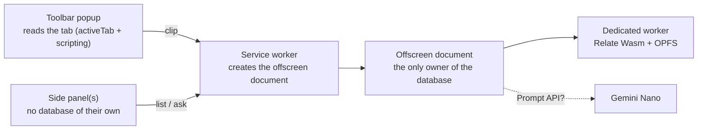

# Spike: clip from the toolbar without opening the side panel

Checks whether Linka can clip a page from a toolbar popup (like bookmarking) while the side panel stays closed.



A service worker cannot start a dedicated worker, which OPFS needs, so the database lives in an offscreen document. The popup and every side panel send requests to it instead of opening the store themselves.

## Automated check

```sh
npm install
npx playwright install chromium
npm run build
npm run check
```

It checks that a clip started from the popup finishes after the popup closes, that two side panels can query at once without the OPFS lock, that the offscreen document survives 35 s of idling, and that data survives a browser restart. Playwright's Chromium has no Gemini Nano model, so the Prompt API result is printed for information only.

## Manual check in Chrome

1. `npm run build`, then load `dist/` from `chrome://extensions` (Developer mode → Load unpacked)
2. Pin the extension, open any article, and click its icon. The popup shows the page title, URL and text length
3. Close the popup right away (click on the page) while it says it is clipping
4. Open the side panel from Chrome's side panel button and choose "Linka spike: offscreen clip". The page you clipped is listed
5. Press **AI チェック（offscreen）** and **AI チェック（このパネル）**: each shows whether the Prompt API is available there and, if it is, the JSON it extracted
